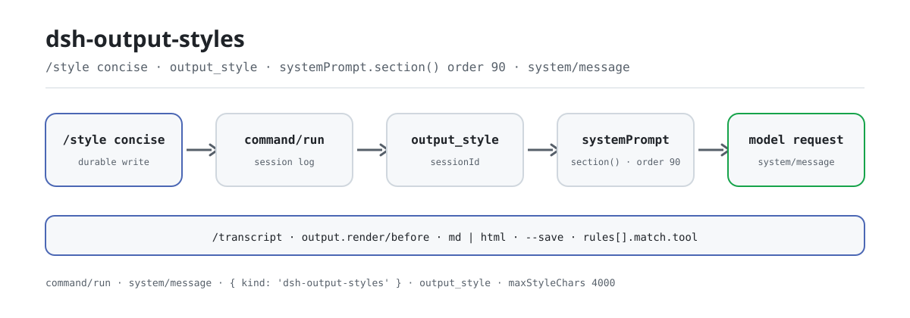

<div align="center">

<picture>
  <source media="(prefers-color-scheme: dark)" srcset="docs/assets/dsh-output-styles-flow-dark.svg">
  
</picture>

# dsh-output-styles

**Cambia el estilo de salida del modelo en tiempo de ejecución: un `/style concise` y todas las respuestas pasan a ser concisas.**

El equivalente de `outputStyles` de Claude Code para DeepSeek Harness: los estilos son archivos Markdown, la elección se persiste por sesión y el cuerpo se inyecta en cada ensamblado del prompt.

[Instalar](#instalación-en-tres-pasos) · [Configuración](#configuración) · [FAQ](#faq) · [简体中文](README.md) · [English](README.en.md) · [Español](README.es.md) · [Português](README.pt.md) · [हिन्दी](README.hi.md)

[](LICENSE)
[](#compatibilidad)
[](https://www.npmjs.com/package/dsh-output-styles)
[](https://github.com/PerryLink/dsh-output-styles/actions/workflows/ci.yml)
[](#compatibilidad)

[](https://github.com/PerryLink/dsh-output-styles/stargazers)
[](https://www.npmjs.com/package/dsh-output-styles)
[](https://dshfind.com/plugins/PerryLink/dsh-output-styles?ref=badge)
[](https://securityscorecards.dev/viewer/?uri=github.com/PerryLink/dsh-output-styles)
[](https://dsh.market/)
[](https://gitee.com/perrylink/dsh-output-styles)

```sh
dsh plugin --profile <name> add dsh-output-styles
```

</div>

<sub>Plugin de la comunidad, no afiliado a DeepSeek. Repositorio canónico: <https://github.com/PerryLink/dsh-output-styles> (Gitee es un espejo).</sub>

## Qué es

`/style concise` — y a partir de ahora toda respuesta es concisa; `/style off` — de vuelta al valor por defecto del proyecto. `dsh-output-styles` lleva `outputStyles` de Claude Code a DeepSeek Harness: un estilo es un archivo Markdown (frontmatter para metadatos, cuerpo como directiva del modelo), seis vienen integrados, la elección vive en el dominio de almacenamiento `output_style` indexada por sessionId y sobrevive a los reinicios, y el cuerpo actual se inyecta en el prompt del sistema en cada ensamblado, truncado a un presupuesto configurable. Los estilos se aplican solo a la conversación principal; las sesiones de subagente conservan sus propios prompts (igual que Claude Code).

### Cómo funciona

```mermaid
flowchart LR
    U[You type /style concise] --> C[command registry]
    C -->|command/run logged| L[(session log)]
    C -->|put {style, source}| D[(output_style domain)]
    D --> R[OutputStyleRuntime]
    R -->|body at every assembly| S[systemPrompt section order 90]
    S --> M[Model request]
    M -->|full system prompt| H[system/message logged]
```

Todo lo que ve el modelo es reconstruible desde el registro de sesión: sin un nuevo tipo de evento de sesión, sin cambios en el agent-loop. El nombre del estilo viene de `command/run`, el texto exacto inyectado de `system/message`, y el marcador de procedencia `{ kind: 'dsh-output-styles' }` viaja en el registro del dominio.

### Demostración

```text
You > /style
      output style off
      concise — Terse, direct answers — minimal prose, no preamble. (Daily coding work, tool-heavy sessions, or when prompt length matters.)
      explanatory — Educational answers with short "Insights" that teach as you work. (Learning a codebase, onboarding, …)
      formal — Formal, precise prose with complete sentences and defined terms. (Reports, documentation, release notes, …)
      learning — Collaborative learn-by-doing mode with short "Insights" and small hands-on steps for the user. (Pairing, onboarding, …)
      proactive — Execute immediately, assume reasonable defaults, and prefer action over planning. (Routine multi-step work, …)
      step-by-step — Numbered reasoning steps with explicit intermediate results. (Debugging, design decisions, …)

You > /style concise
      switched to concise

You > 请只用一句话介绍你自己。
AI  > 我是运行在 DeepSeek Harness 插件化平台上、基于 deepseek-v4-pro 模型的 AI 编码代理。
```

## Instalación en tres pasos

1. **Instalar** (elige un canal):

   ```sh
   # canal git (último main; el script prepare compila solo con dependencias de producción)
   dsh plugin --profile web add github:PerryLink/dsh-output-styles
   # canal npm (versiones publicadas)
   dsh plugin --profile web add dsh-output-styles
   # canal tarball: pnpm pack en este repositorio y luego
   dsh plugin --profile web add ./dsh-output-styles-<version>.tgz
   ```

2. **Configuración mínima** (los valores por defecto ya sirven; fija el estilo del proyecto para sesiones nuevas si lo necesitas):

   ```yaml
   - insert:
       - id: output-styles
         name: dsh-output-styles
         config:
           defaultStyle: concise
   ```

3. **Verificar que funciona**:

   ```sh
   dsh --profile web --dump-config | grep -A3 'id: output-styles'
   ```

   ```text
   > /style
         output style off
         concise — Terse, direct answers — minimal prose, no preamble. (…)
   > /style concise
         switched to concise
   ```

**Desinstalar**: `dsh plugin --profile web remove dsh-output-styles` (o borra la fila del patch del perfil).

<details>
<summary>Instalar desde el mercado de DSH Desktop</summary>

Todos los plugins de PerryLink aparecen en el mercado integrado de DSH Desktop: **Mercado → Fuentes → Añadir fuente → pega** `https://perrylink-dsh-catalog.perrylink.workers.dev/catalog-source.json` **→ selecciona**. La instalación sigue requiriendo la verificación de identidad npm del mercado y tu confirmación.

</details>

## Capacidades clave

`dsh-output-styles` es el equivalente de `outputStyles` de Claude Code para DeepSeek Harness: un comando `/style` que cambia el estilo de salida del modelo en tiempo de ejecución, lo persiste por sesión y lo inyecta en cada ensamblado del prompt.

- **Librería de estilos** — un archivo Markdown por estilo (`styles/*.md`); frontmatter para metadatos, cuerpo = la directiva del modelo. Seis estilos integrados (`concise`, `explanatory`, `formal`, `learning`, `proactive`, `step-by-step`), incluidos `proactive` y `learning` con paridad Claude Code.
- **Comando `/style`** — sin argumento lista los estilos (con descripciones) más la selección actual; `/style <name>` cambia; `/style off` restaura el valor por defecto del proyecto.
- **Persistencia por sesión** — la elección vive en el dominio de almacenamiento `output_style`, indexada por sessionId, y sobrevive a los reinicios.
- **Inyección en el prompt del sistema** — una contribución `systemPrompt.section()` (orden `sectionOrder`) inyecta el cuerpo del estilo actual en cada ensamblado, truncado a un presupuesto configurable.
- **Paridad Claude Code** — `keep-coding-instructions`, `force-for-plugin` (alias `force`), compatibilidad JSON `outputStyles`, directorios `stylesDir` por capas, recarga en caliente y un fallback del proyecto editable en vivo desde la página **Plugins** de la Web.
- **Registro de renderers (`output.render.*`)** — `ctx.outputRenderers` permite a cualquier plugin registrar un presenter puro, aplicado a través de la cascada `output.render/before`; renderers integrados `concise` y `step-by-step`.
- **Reglas por sesión/por herramienta** — `rules: [{ match: { tool: 'bash' }, style: 'concise' }]` nombran el renderer para solicitudes coincidentes; editables en vivo desde la página **Plugins** de la Web.
- **`/transcript`** — renderiza la sesión actual a Markdown o HTML saneado a través de la tubería de render; `--save <path>` escribe el documento saneado en esa ruta de workspace tras la aprobación del usuario. Cada render conserva el texto original junto al renderizado.

### Superficie de comandos y herramientas

| Superficie | Tipo | Notas |
|---|---|---|
| `/style` | command | Lista estilos, cambia o restaura el valor por defecto del proyecto |
| `/transcript` | command | Renderiza la sesión actual a Markdown o HTML saneado; `--save` escribe con aprobación |
| `output_style` | storage domain | Elección de estilo por sesión, indexada por sessionId |
| `systemPrompt.section()` | contribution | Inyecta el cuerpo del estilo actual en cada ensamblado |
| `output.render.*` | renderer registry | `ctx.outputRenderers` + la cascada `output.render/before` |
| `style` | projection | `{ options, currentValue }` plegado desde comandos asentados |
| Web picker | client entry | `dsh-output-styles/client` decora `/style` con un selector emergente |

### Referencia de comandos

| Entrada | Resultado |
|---|---|
| `/style` | Lista la selección actual + una línea por estilo (nombre — descripción) |
| `/style concise` | Cambia (escritura durable), `switched to concise` |
| `/style Diagrams first` | Los nombres de varias palabras son el resto completo |
| `/style off` | Restaura el valor por defecto del proyecto (default de settings, luego `defaultStyle`) |
| `/style nope` | `error: unknown output style "nope" (available: …)` |
| `/transcript` | Renderiza la sesión actual a Markdown a través de la pipeline de render |
| `/transcript md` | Renderiza a Markdown (`md` es la forma abreviada de `markdown`) |
| `/transcript html` | Renderiza a HTML saneado |
| `/transcript --renderer=concise` | Renderiza forzando un renderer (reglas omitidas) |
| `/transcript md --save report.md` | Renderiza y luego escribe el documento saneado en `report.md` tras la aprobación |

### Ejemplos

Estos son los puntos de entrada reales del plugin; instala una vez y llama a uno.

**Ejemplo detallado** — comando `/style concise`, salida:

```text
switched to concise
```

*Observed from `plugins/dsh-output-styles/src/runtime.ts:474-478; asserted in tests/runtime.spec.ts:91; README §Command reference line 194`*

**Rama de fallo** — entrada `/style nope`, salida:

```text
unknown output style "nope" (available: concise, explanatory, formal, learning, proactive, step-by-step)
```

*Observed from `plugins/dsh-output-styles/src/runtime.ts:213-214,474-475; plugins/dsh-output-styles/tests/runtime.spec.ts:118-125`*

**Ejemplos breves**: `/transcript` · `output_style`

### Librería de estilos

Un archivo Markdown por estilo; frontmatter para metadatos, cuerpo = la directiva del modelo. `name` toma por defecto el nombre del archivo y puede contener espacios (`Diagrams first`).

| Campo | Valor por defecto | Significado |
|---|---|---|
| `name` | nombre del archivo | Destino del cambio; letras, dígitos, espacios y guiones (`off` está reservado) |
| `description` | — (obligatorio) | Una frase mostrada en listados y el selector |
| `whenToUse` | — | Guía opcional añadida a los listados |
| `keep-coding-instructions` | `false` | Mantener el prompt del harness cuando `true`; reemplazarlo cuando `false` (semántica Claude Code) |
| `force-for-plugin` | `false` | Aplicar incondicionalmente, sobrescribiendo cualquier selección de sesión; `force` es un alias, a lo sumo un estilo puede fijarlo |

Con `compatJson: true`, las entradas JSON `outputStyles` de Claude Code (`{ name, description, prompt }`) cargan junto a los estilos Markdown; las entradas no analizables se omiten con una advertencia.

### Protocolo de renderers

El protocolo `output.render.*` convierte la presentación en un punto de extensión. Un renderer es un **presenter puro** — `presenter(text, context)` mapea argumentos a datos de visualización, nunca toca el DOM — emparejado por nombre de herramienta y tipo de contenido, ordenado por prioridad.

- **Waterfall primero**: toda solicitud de render pasa por `output.render/before` (`{ text, context }`); los listeners deben llamar `next()`.
- **Rules**: `rules: [{ match: { tool: 'bash' }, style: 'concise' }]` nombra el renderer para solicitudes coincidentes; los empates se resuelven por `priority` y luego por orden de regla.
- **Built-ins**: `concise` (compactación de espacios + truncado por presupuesto) y `step-by-step` (numeración de pasos consistente).
- **Auditabilidad**: cada resultado de render lleva `{ original, rendered, rendererId, changed }`; el texto renderizado es lo que se muestra, el original sigue siendo reconstruible desde el registro de sesión.

### Selector Web

La entrada `dsh.client` decora la invocación desnuda del comando `/style` con un selector emergente: una fila "off" más una fila por estilo de la librería (`description · whenToUse`), con la fila activa marcada. Elegir envía `/style <name>` a través del Remote de comandos, de modo que cada cambio conserva el ciclo de vida durable del comando host. El selector sigue el par de idiomas `zh`/`en` de la Web UI.

## Configuración

Todos los parámetros son campos Schemastery `Config` (modificables desde cordis.yml). Los valores inválidos fallan la carga.

`defaultStyle` y `rules` están declarados `volatile()`, así que en un host que compone la costura de formularios de settings son **campos vivos, editables en la Web**: edítalos en **Plugins → dsh-output-styles** de la interfaz Web y el plugin en ejecución adopta el nuevo valor sin remontarse. Todos los demás campos siguen siendo solo de composición y requieren una recarga. Un valor confirmado se valida antes de aplicarse — si es inválido se rechaza y los valores en ejecución no cambian.

Claves más usadas:

| Clave | Valor por defecto | Editable en Web | Significado |
|---|---|---|---|
| `stylesDir` | `[]` | No | Directorios de la librería, resueltos contra cwd; las entradas posteriores sobrescriben las anteriores. `[]` = solo los `styles/` integrados |
| `maxStyleChars` | `4000` | No | Presupuesto del cuerpo del estilo (≥ 1); los cuerpos más largos se truncan con un marcador |
| `defaultStyle` | `''` | **Sí** | Estilo para sesiones que nunca eligieron uno; `''` = sin estilo. Un nombre que no está en la librería viva se rechaza en lugar de inyectarse |
| `compatJson` | `true` | No | Cargar entradas JSON `outputStyles` de Claude Code (objetos sueltos o arrays) |
| `sectionOrder` | `90` | No | Orden de la sección inyectada (0 = persona, 100–199 = guía de herramientas) |
| `includeBuiltins` | `true` | No | Incluir los `styles/` del paquete como capa de menor prioridad |
| `watchStyles` | `true` | No | Recargar la librería cuando un archivo de estilo cambia en disco |
| `rules` | `[]` | **Sí** | Reglas de render por sesión/herramienta: `[{ match: { tool?, contentType?, session? }, style, priority? }]` |

<details>
<summary>Tabla de configuración completa (11 claves)</summary>

| Clave | Valor por defecto | Editable en Web | Significado |
|---|---|---|---|
| `stylesDir` | `[]` | No | Directorios de la librería, resueltos contra cwd; las entradas posteriores sobrescriben las anteriores. `[]` = solo los `styles/` integrados |
| `maxStyleChars` | `4000` | No | Presupuesto del cuerpo del estilo (≥ 1); los cuerpos más largos se truncan con un marcador |
| `defaultStyle` | `''` | **Sí** | Estilo para sesiones que nunca eligieron uno; `''` = sin estilo. Un nombre que no está en la librería viva se rechaza en lugar de inyectarse |
| `compatJson` | `true` | No | Cargar entradas JSON `outputStyles` de Claude Code (objetos sueltos o arrays) |
| `sectionOrder` | `90` | No | Orden de la sección inyectada (0 = persona, 100–199 = guía de herramientas) |
| `truncationMarker` | `"\n\n[style truncated]"` | No | Marcador añadido en el punto de truncado |
| `includeBuiltins` | `true` | No | Incluir los `styles/` del paquete como capa de menor prioridad |
| `watchStyles` | `true` | No | Recargar la librería cuando un archivo de estilo cambia en disco |
| `rules` | `[]` | **Sí** | Reglas de render por sesión/herramienta: `[{ match: { tool?, contentType?, session? }, style, priority? }]` |
| `enableExport` | `true` | No | Registrar el comando `/transcript` (exportación de sesión Markdown/HTML, consciente del renderer; `--save` escribe con aprobación) |
| `respectCoreOutputStyles` | `true` | No | Al detectar un servicio core `outputStyles`, omitir la inyección de prompt de este plugin (mantener hot-switch / rules / export) |

</details>

Ejemplo de override en el patch del perfil:

```yaml
- insert:
    - id: output-styles
      name: dsh-output-styles
      config:
        defaultStyle: concise
        rules:
          - match: { tool: bash }
            style: concise
```

**Migración desde 0.1.6 o anterior.** Esas versiones mantenían dos secciones de settings propias del plugin, `output-style` (`style`) y `output-style-rules` (`rules`). El host 0.1.7 eliminó la API sobre la que se construyeron, así que ambas secciones ya no existen. Mueve cualquier valor que tuvieras ahí al campo `Config` correspondiente — `output-style.style` → `defaultStyle`, `output-style-rules.rules` → `rules` — en el patch de tu perfil (`cordis.yml`), o defínelo en la página Plugins. Las elecciones por sesión hechas con `/style` no se ven afectadas: viven en el dominio de almacenamiento `output_style`.

## FAQ

<details>
<summary>¿Dónde se guarda la elección de estilo? ¿Sobrevive a un reinicio?</summary>

La elección vive en el dominio de almacenamiento `output_style`, indexada por sessionId, y sobrevive a los reinicios. No se persiste ningún otro estado y no hay solicitudes de red. Los cuerpos de estilo vienen de los directorios `styles/` y de `stylesDir`; se releen en cada ensamblado (con `watchStyles` activo también se recargan en caliente).

</details>

<details>
<summary>Cambié `defaultStyle` en la Web y no pasó nada, ¿por qué?</summary>

`defaultStyle` y `rules` son campos `volatile()`: solo son campos vivos editables en la Web cuando el host compone la costura de formularios de settings. Si no, siguen siendo solo de composición y requieren recargar el perfil. Un valor confirmado se valida — un nombre inválido se rechaza y los valores en ejecución no cambian.

</details>

<details>
<summary>¿Qué pasa si el core incorpora un `outputStyles` de primera parte?</summary>

No hay conflicto silencioso. Cuando el plugin detecta un servicio core `outputStyles`, degrada a la superficie incremental (hot-switch / rules / `/transcript`) y deja la inyección del prompt al core; cada respuesta de `/style` y `/style off` lleva una nota `degraded coexistence mode`, y la proyección de sesión `style` expone `promptInjection: 'enabled' | 'disabled'`, así que ninguna superficie insinúa que el estilo está en vigor cuando no lo está. El argumento completo está en [`docs/COEXISTENCE.md`](docs/COEXISTENCE.md).

</details>

<details>
<summary>¿Cuánto cuesta en rendimiento?</summary>

Sin solicitudes de red y sin llamadas al modelo. El plugin observa `system-prompt/assemble` e incorpora el cuerpo del estilo actual (truncado a `maxStyleChars`, 4000 caracteres por defecto) al prompt del sistema; todos los listeners delegan por `next()`, así que la cadena nunca se cortocircuita.

</details>

<details>
<summary>¿Las sesiones de subagente heredan el estilo?</summary>

No. Los estilos se aplican solo a la conversación principal; las sesiones de subagente conservan sus propios prompts, igual que Claude Code.

</details>

## Límites de seguridad

- **Solo servicios públicos.** Contribuye `systemPrompt`, comandos, almacenamiento y settings; sin cambios en engine / agent-loop / apiproxy / UI oficial.
- **Visible para el modelo ⟺ registrado.** Todo lo que el modelo ve es reconstruible desde el registro de sesión — sin un nuevo tipo de evento de sesión, sin cambios en el agent-loop.
- **Original siempre conservado.** Cada render (y `/transcript`) conserva el texto original junto al renderizado; para la exportación HTML se usa HTML saneado.
- **Escrituras en disco controladas.** `/transcript --save` escribe solo después de que el servicio de aprobación lo conceda, y el contenido escrito pasa primero por la función pura `sanitizeText`; sin un servicio de aprobación o fs no escribe nada (fail-closed).

## Permisos y datos

- **Permisos**: el manifiesto de workshop declara `fs:read`, `fs:write`, `fs:watch`, `storage:read`, `storage:write` y `settings:read`.
- **Datos**: la elección de estilo vive en el dominio de almacenamiento `output_style` (indexada por sessionId); no se persiste otro estado, sin solicitudes de red.
- **Registro de sesión**: el nombre del estilo viene de `command/run`, el texto exacto inyectado de `system/message`; el marcador de procedencia `{ kind: 'dsh-output-styles' }` viaja en el registro del dominio.

## Limitaciones conocidas

- **Coexistencia con el core.** Si aparece una capacidad `outputStyles` de primera parte, este plugin detecta su servicio `outputStyles` y degrada a la superficie incremental (hot-switch, rules, `/transcript`) dejando la inyección del prompt al core — ver [`docs/COEXISTENCE.md`](docs/COEXISTENCE.md) y las funciones exportadas `detectCoreOutputStyles` / `coexistenceReport`. **El modo degradado se declara donde se ve**: cada respuesta de `/style <estilo>` y `/style off` lleva una nota `degraded coexistence mode`, y la proyección de sesión `style` expone `promptInjection: 'enabled' | 'disabled'`, así que ninguna superficie insinúa que el estilo está en vigor cuando no lo está. (Antes de 0.7.0 el único rastro era una línea `ctx.logger.info`, que nunca llega a la transcripción.)
- **Solo conversación principal.** Los estilos se aplican a la conversación principal; las sesiones de subagente conservan sus propios prompts (igual que Claude Code).
- **Truncado.** Los cuerpos de estilo más largos que `maxStyleChars` se truncan con un marcador.
- **Archivos omitidos.** Un archivo de estilo defectuoso se omite con una advertencia y nunca rompe el profile.

## Interoperabilidad con otros plugins DSH

Verificado contra **DSH `0.2.0-rc.2`** (el runtime para el que se publica este README) y el conjunto de plugins con más estrellas sondeado el 2026-10-05.

Este plugin **no interfiere** con otros plugins, incluidos los de más estrellas:

- **Sin colisión de nombres de herramienta.** Todas las herramientas llevan espacio de nombres; ninguna ocupa un nombre desnudo ya perteneciente a una herramienta incluida u otro plugin.
- **Sin colisión de clave de servicio.** Solo provee `outputRenderers`; esa clave no es una costura incluida ni la provee ningún plugin de más estrellas.
- **Sin colisión de slot.** No registra ninguna clave de slot de cliente, así que no disputa un asiento `shadows-shipped-ui`.
- **Sin colisión de ruta HTTP.** No registra ningún prefijo `webServer`.
- **Sin colisión en la capa de patch.** El patch del bundle solo hace `insert` de su propia fila; nunca sobrescribe el `config` de una fila incluida.
- **Sin mutación global.** No parchea prototipos, ni reescribe `process.env`, ni reemplaza el dispatcher global de fetch.

**Los listeners de eventos compartidos no interfieren por construcción.** Observa el evento sensible al orden `system-prompt/assemble` con `ctx.on()` — el registro de difusión de Cordis, donde cada listener se ejecuta y ninguno puede dejar sin turno a otro. **Todos los listeners aquí delegan por `next()`**, así que la cadena nunca se cortocircuita:

- `system-prompt/assemble` — also used by `dsh-routing-suite` (7000★, 13 listeners).

Evidencia estática: `dsh-plugin-doctor` K10–K13 dan `pass` en todas las comprobaciones de este repositorio.

### Verificación de conflictos

Filtrado contra el ecosistema DSH antes del desarrollo (instantánea 2026-08): ningún repositorio `style`/`output-style` bajo [topic:dsh-plugin](https://github.com/topics/dsh-plugin), ninguna categoría de output-style en las cuatro principales [awesome lists](https://github.com/awesome-dsh-plugin/awesome-dsh-plugin), y ninguna entrada en el [catálogo dsh-hub](https://github.com/omdsh-dev/dsh-hub-workshop). Los vecinos más cercanos — [dsh-soul-md](https://github.com/Scorp1o117/dsh-soul-md) (persona) y [dsh-claude-marketplace](https://github.com/ben7am1n/dsh-claude-marketplace) (estilos de salida diferidos explícitamente a v0.2+) — son adyacentes, no conflictivos.

## Compatibilidad

| Superficie | Estado |
|---|---|
| Harness | DeepSeek Harness `dsh-v0.2.1-rc.2` (adaptado el 2026-09-09): el sobre de sesión conserva su campo ignorable solo para compatibilidad de lectura de logs almacenados — Session.append aún no puede estamparlo, por lo que el comportamiento de la puerta no cambia. Verificado el 2026-09-11 contra el checkout dsh-v0.2.1-rc.2 (cadena de puertas completa + smoke de instalación del perfil). |
| Node | `^22.19.0 \|\| >=24.9.0` |
| Plataformas | Todas (host + cliente web) |
| Modelo | Cualquiera (inyección en el prompt del sistema) |

### Diferencias con Claude Code

| | Claude Code | dsh-output-styles |
|---|---|---|
| Archivos de estilo | `.claude/output-styles` en niveles usuario/proyecto/gestionado | directorios `stylesDir` + `styles/` integrados, gana el directorio posterior |
| Estilos personalizados | Markdown, frontmatter `name`/`description`/`keep-coding-instructions`/`force-for-plugin` | Mismos campos (`force-for-plugin` aceptado textualmente, `force` como alias) + `whenToUse` |
| JSON heredado | array `outputStyles` en `settings.json` | Cargado textualmente (`compatJson: true`) |
| Cuándo entra en vigor | Después de `/clear` o una sesión nueva | Inmediatamente — el prompt del sistema se reensambla por solicitud |
| Subagentes | Los estilos no se aplican | Igual — las sesiones de subagente conservan sus propios prompts |
| Cambio | menú `/config` o ajuste `outputStyle` (el comando `/output-style` se eliminó en v2.1.91) | comando `/style` + Web picker + campo `defaultStyle` en la página Plugins de la Web |

## Ecosistema y calidad

- [Espejo en Gitee](https://gitee.com/perrylink/dsh-output-styles) (espejo de sincronización; GitHub es canónico)
- [Página del plugin en dshfind](https://dshfind.com/plugins/PerryLink/dsh-output-styles) (instalaciones y ranking)
- [Informe de OpenSSF Scorecard](https://securityscorecards.dev/viewer/?uri=github.com/PerryLink/dsh-output-styles) (impulsado por [.github/workflows/scorecard.yml](.github/workflows/scorecard.yml))
- [Informe de verificación de dsh-plugin-doctor](https://github.com/PerryLink/dsh-plugin-doctor#verified-徽章) (K10–K13 todos `pass`)
- [DSH Market](https://dsh.market/) (listado)
- **Canal de la tienda 1024**: ejecuta `npm i -g dsh1024` una vez y luego `dsh1024 plugin --profile web add dsh-output-styles` (cuenta para el ranking de instalaciones de [deepseek1024.com](https://deepseek1024.com))
- [Base de conocimiento del ecosistema](https://perrylink.github.io/dsh-plugin-guide/) — datos medidos, no marketing: guía de desarrollo de plugins · datos de selección · criterios de mantenimiento

## Desarrollo

```sh
pnpm install
pnpm run typecheck     # ambos proyectos tsc
pnpm test              # vitest — 156 tests
pnpm run verify        # typecheck + tests + self-contained (la puerta de prepublishOnly)
pnpm run check:readmes # puerta de consistencia de los README en cinco idiomas
pnpm run build         # artefactos lib/ (bundles host + client)
pnpm pack              # tarball para dsh plugin add
```

Lanzamientos: empujar una etiqueta `v*` cuyo sufijo coincide con la versión de `package.json` dispara el workflow Publish — verificación completa y luego publicación a npm con procedencia.

Las imágenes del README se generan de forma programática con [`scripts/gen-readme-assets.py`](scripts/gen-readme-assets.py) (Python + Pillow); volver a ejecutarlo sobrescribe `docs/assets/dsh-output-styles-flow-{light,dark}.svg`. Este repositorio no tiene datos de benchmark, así que no hay gráfico de evidencia.

Topics: `deepseek-harness`, `dsh`, `dsh-plugin`, `output-style`, `output-styles`, `claude-code`

## Familia y agradecimientos

Este proyecto forma parte de la familia de plugins de DeepSeek Harness de [PerryLink](https://github.com/PerryLink) (todos Apache-2.0). Si te resulta útil, **una estrella ayuda a que la siguiente persona lo encuentre** — nada queda bloqueado tras ella.

- [@kskazuha](https://github.com/kskazuha) — la revitalización del selector de estilos Web en 0.1.7 (#8).
- [@Bingtang1019](https://github.com/Bingtang1019) — el informe de traspaso de la tabla de módulos de `lib/client.js` (#10).
- [@PerryLink](https://github.com/PerryLink) — autor y mantenedor: arquitectura del plugin, librería de estilos, instalación de bundle, Web picker, documentación en cinco idiomas y herramientas de CI/lanzamiento.

<details>
<summary>Expandir todos los plugins</summary>

| Plugin | Estado |
|---|---|
| **[dsh-aqua-input-check](https://github.com/PerryLink/dsh-aqua-input-check)** |  |
| **[dsh-archive-check](https://github.com/PerryLink/dsh-archive-check)** |  |
| **[dsh-auto-review](https://github.com/PerryLink/dsh-auto-review)** |  |
| **[dsh-autotier](https://github.com/PerryLink/dsh-autotier)** | 🧊 CONGELADO — ver el README del repo |
| **[dsh-bid-ca-precheck](https://github.com/PerryLink/dsh-bid-ca-precheck)** |  |
| **[dsh-bid-qual-check](https://github.com/PerryLink/dsh-bid-qual-check)** |  |
| **[dsh-cert-mcp](https://github.com/PerryLink/dsh-cert-mcp)** | 🧊 CONGELADO — ver el README del repo |
| **[dsh-checkpoint-rewind](https://github.com/PerryLink/dsh-checkpoint-rewind)** |  |
| **[dsh-click](https://github.com/PerryLink/dsh-click)** |  |
| **[dsh-composer-history](https://github.com/PerryLink/dsh-composer-history)** |  |
| **[dsh-contract-stance](https://github.com/PerryLink/dsh-contract-stance)** |  |
| **[dsh-customs-doc-check](https://github.com/PerryLink/dsh-customs-doc-check)** |  |
| **[dsh-data-quality](https://github.com/PerryLink/dsh-data-quality)** | 🧊 CONGELADO — ver el README del repo |
| **[dsh-demurrage-ledger](https://github.com/PerryLink/dsh-demurrage-ledger)** |  |
| **[dsh-doublecheck](https://github.com/PerryLink/dsh-doublecheck)** |  |
| **[dsh-drill-script-check](https://github.com/PerryLink/dsh-drill-script-check)** |  |
| **[dsh-eia-guide-check](https://github.com/PerryLink/dsh-eia-guide-check)** |  |
| **[dsh-emergency-plan](https://github.com/PerryLink/dsh-emergency-plan)** |  |
| **[dsh-essay-rubric-check](https://github.com/PerryLink/dsh-essay-rubric-check)** |  |
| **[dsh-evidence-check](https://github.com/PerryLink/dsh-evidence-check)** |  |
| **[dsh-export-ctl-check](https://github.com/PerryLink/dsh-export-ctl-check)** |  |
| **[dsh-fast](https://github.com/PerryLink/dsh-fast)** |  |
| **[dsh-fmea-table-check](https://github.com/PerryLink/dsh-fmea-table-check)** |  |
| **[dsh-forecast-penalty](https://github.com/PerryLink/dsh-forecast-penalty)** |  |
| **[dsh-fund-research](https://github.com/PerryLink/dsh-fund-research)** |  |
| **[dsh-github](https://github.com/PerryLink/dsh-github)** |  |
| **[dsh-gongwen-flow-check](https://github.com/PerryLink/dsh-gongwen-flow-check)** |  |
| **[dsh-gongwen-word-check](https://github.com/PerryLink/dsh-gongwen-word-check)** |  |
| **[dsh-guard-plan-qc](https://github.com/PerryLink/dsh-guard-plan-qc)** |  |
| **[dsh-hazchem-check](https://github.com/PerryLink/dsh-hazchem-check)** |  |
| **[dsh-hazplan-check](https://github.com/PerryLink/dsh-hazplan-check)** |  |
| **[dsh-hidden-risk-map](https://github.com/PerryLink/dsh-hidden-risk-map)** |  |
| **[dsh-hs-classify](https://github.com/PerryLink/dsh-hs-classify)** |  |
| **[dsh-icd-rule-check](https://github.com/PerryLink/dsh-icd-rule-check)** |  |
| **[dsh-industry-research](https://github.com/PerryLink/dsh-industry-research)** |  |
| **[dsh-lawcite-adapter](https://github.com/PerryLink/dsh-lawcite-adapter)** |  |
| **[dsh-laya](https://github.com/PerryLink/dsh-laya)** |  |
| **[dsh-lc-doc-check](https://github.com/PerryLink/dsh-lc-doc-check)** |  |
| **[dsh-learning-gap-check](https://github.com/PerryLink/dsh-learning-gap-check)** |  |
| **[dsh-library](https://github.com/PerryLink/dsh-library)** |  |
| **[dsh-local-ai](https://github.com/PerryLink/dsh-local-ai)** |  |
| **[dsh-lsp-actions](https://github.com/PerryLink/dsh-lsp-actions)** |  |
| **[dsh-mask](https://github.com/PerryLink/dsh-mask)** |  |
| **[dsh-mcp-panel](https://github.com/PerryLink/dsh-mcp-panel)** |  |
| **[dsh-medrec-qc](https://github.com/PerryLink/dsh-medrec-qc)** |  |
| **[dsh-memento](https://github.com/PerryLink/dsh-memento)** | 🧊 CONGELADO — ver el README del repo |
| **[dsh-nsfc-form-check](https://github.com/PerryLink/dsh-nsfc-form-check)** |  |
| **[dsh-nurse-record-check](https://github.com/PerryLink/dsh-nurse-record-check)** |  |
| **[dsh-observe](https://github.com/PerryLink/dsh-observe)** |  |
| **[dsh-origin-rvc-check](https://github.com/PerryLink/dsh-origin-rvc-check)** |  |
| **[dsh-ota-review-check](https://github.com/PerryLink/dsh-ota-review-check)** |  |
| **[dsh-output-styles](https://github.com/PerryLink/dsh-output-styles)** |  |
| **[dsh-paper-doc-adapter](https://github.com/PerryLink/dsh-paper-doc-adapter)** |  |
| **[dsh-permission-rules](https://github.com/PerryLink/dsh-permission-rules)** |  |
| **[dsh-permit-report-check](https://github.com/PerryLink/dsh-permit-report-check)** |  |
| **[dsh-pipeline-check](https://github.com/PerryLink/dsh-pipeline-check)** |  |
| **[dsh-pleading-draft](https://github.com/PerryLink/dsh-pleading-draft)** |  |
| **[dsh-plugin-doctor](https://github.com/PerryLink/dsh-plugin-doctor)** | 🚫 RETIRADO (repo archivado) |
| **[dsh-plugin-guide](https://github.com/PerryLink/dsh-plugin-guide)** |  |
| **[dsh-plugin-kit](https://github.com/PerryLink/dsh-plugin-kit)** | 🚫 RETIRADO (repo archivado) |
| **[dsh-plugin-upgrade](https://github.com/PerryLink/dsh-plugin-upgrade)** | 🚫 RETIRADO (repo archivado) |
| **[dsh-policy-brief-draft](https://github.com/PerryLink/dsh-policy-brief-draft)** |  |
| **[dsh-power-loss-split](https://github.com/PerryLink/dsh-power-loss-split)** |  |
| **[dsh-power-ticket-check](https://github.com/PerryLink/dsh-power-ticket-check)** |  |
| **[dsh-ppap-check](https://github.com/PerryLink/dsh-ppap-check)** |  |
| **[dsh-protest-deadline](https://github.com/PerryLink/dsh-protest-deadline)** |  |
| **[dsh-railway-window](https://github.com/PerryLink/dsh-railway-window)** |  |
| **[dsh-repair-order-qc](https://github.com/PerryLink/dsh-repair-order-qc)** |  |
| **[dsh-research-report](https://github.com/PerryLink/dsh-research-report)** |  |
| **[dsh-review-reply-check](https://github.com/PerryLink/dsh-review-reply-check)** |  |
| **[dsh-rulefile-check](https://github.com/PerryLink/dsh-rulefile-check)** |  |
| **[dsh-safety-brief-check](https://github.com/PerryLink/dsh-safety-brief-check)** |  |
| **[dsh-score](https://github.com/PerryLink/dsh-score)** | 🧊 CONGELADO — ver el README del repo |
| **[dsh-session-sync](https://github.com/PerryLink/dsh-session-sync)** |  |
| **[dsh-site-log-check](https://github.com/PerryLink/dsh-site-log-check)** |  |
| **[dsh-skill-pack-security](https://github.com/PerryLink/dsh-skill-pack-security)** |  |
| **[dsh-soe-decision-check](https://github.com/PerryLink/dsh-soe-decision-check)** |  |
| **[dsh-soilwater-check](https://github.com/PerryLink/dsh-soilwater-check)** |  |
| **[dsh-sop-sync-check](https://github.com/PerryLink/dsh-sop-sync-check)** |  |
| **[dsh-spc-gbt-adapter](https://github.com/PerryLink/dsh-spc-gbt-adapter)** |  |
| **[dsh-talk](https://github.com/PerryLink/dsh-talk)** |  |
| **[dsh-tender-extract](https://github.com/PerryLink/dsh-tender-extract)** |  |
| **[dsh-tender-matrix](https://github.com/PerryLink/dsh-tender-matrix)** |  |
| **[dsh-test-drive](https://github.com/PerryLink/dsh-test-drive)** |  |
| **[dsh-ticktick](https://github.com/PerryLink/dsh-ticktick)** | 🚫 RETIRADO (repo archivado) |
| **[dsh-translate](https://github.com/PerryLink/dsh-translate)** |  |
| **[dsh-warranty-calc](https://github.com/PerryLink/dsh-warranty-calc)** |  |
| **[dsh-budget](https://github.com/PerryLink/dsh-budget)** | 🧊 CONGELADO — ver el README del repo |
| **[dsh-claude-move](https://github.com/PerryLink/dsh-claude-move)** | 🧊 CONGELADO — ver el README del repo |
| **[dsh-defend](https://github.com/PerryLink/dsh-defend)** | 🧊 CONGELADO — ver el README del repo |
| **[dsh-draw](https://github.com/PerryLink/dsh-draw)** | 🧊 CONGELADO — ver el README del repo |
| **[dsh-reach](https://github.com/PerryLink/dsh-reach)** | 🧊 CONGELADO — ver el README del repo |
| **[dsh-background-agents](https://github.com/PerryLink/dsh-background-agents)** | 🚫 RETIRADO (repo archivado) |
| **[dsh-session-pin](https://github.com/PerryLink/dsh-session-pin)** | 🚫 RETIRADO (repo archivado) |
| **[dsh-team-rooms](https://github.com/PerryLink/dsh-team-rooms)** | 🚫 RETIRADO (repo archivado) |

</details>

## Licencia

[LICENSE](LICENSE) (Apache License 2.0) © 2026 dsh-output-styles contributors

<p align="center"><sub>Apache-2.0 · Plugin de la comunidad, no afiliado a DeepSeek.</sub></p>
