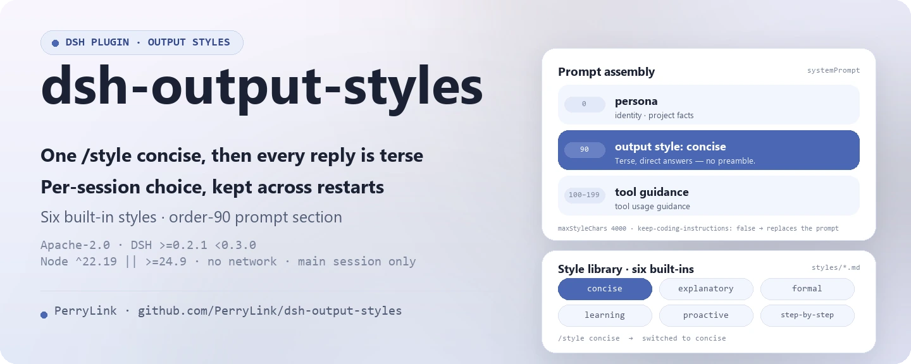

<div align="center">

<picture>
  <source media="(prefers-color-scheme: dark)" srcset="docs/assets/dsh-output-styles-hero-en-dark.webp">
  
</picture>

# dsh-output-styles

**रनटाइम पर मॉडल की आउटपुट शैली बदलें — एक `/style concise` और इसके बाद हर उत्तर संक्षिप्त।**

DeepSeek Harness के लिए Claude Code `outputStyles` का समकक्ष: शैलियाँ Markdown फ़ाइलें हैं, चयन प्रति-सत्र स्थायी रहता है, और हर प्रॉम्प्ट संयोजन पर शैली का मुख्य भाग इंजेक्ट होता है।

[इंस्टॉल](#तीन-चरणों-में-शुरुआत) · [कॉन्फ़िगरेशन](#कॉन्फ़िगरेशन) · [FAQ](#faq) · [简体中文](README.md) · [English](README.en.md) · [Español](README.es.md) · [Português](README.pt.md) · [हिन्दी](README.hi.md)

[](LICENSE)
[](#संगतता)
[](https://www.npmjs.com/package/dsh-output-styles)
[](https://github.com/PerryLink/dsh-output-styles/actions/workflows/ci.yml)
[](#संगतता)

[](https://github.com/PerryLink/dsh-output-styles/stargazers)
[](https://www.npmjs.com/package/dsh-output-styles)
[](https://dshfind.com/plugins/PerryLink/dsh-output-styles?ref=badge)
[](https://securityscorecards.dev/viewer/?uri=github.com/PerryLink/dsh-output-styles)
[](https://dsh.market/)
[](https://gitee.com/perrylink/dsh-output-styles)

```sh
dsh plugin --profile <name> add dsh-output-styles
```

</div>

<sub>समुदाय प्लगइन, DeepSeek से संबद्ध नहीं। एकमात्र रेपो: <https://github.com/PerryLink/dsh-output-styles> (Gitee एक मिरर है)।</sub>

## यह क्या है

`/style concise` — और अब से हर उत्तर संक्षिप्त; `/style off` — परियोजना के डिफ़ॉल्ट पर वापस। `dsh-output-styles` Claude Code के `outputStyles` को DeepSeek Harness में लाता है: एक शैली एक Markdown फ़ाइल है (मेटाडेटा के लिए frontmatter, मुख्य भाग = मॉडल निर्देश), छह शैलियाँ अंतर्निहित हैं, चयन `output_style` स्टोरेज डोमेन में sessionId से अनुक्रमित रहता है और पुनःआरंभ के बाद भी बना रहता है, और वर्तमान शैली का मुख्य भाग हर संयोजन पर सिस्टम प्रॉम्प्ट में इंजेक्ट होता है, विन्यास-योग्य बजट पर काटा गया। शैलियाँ केवल मुख्य बातचीत पर लागू होती हैं; सबएजेंट सत्र अपने प्रॉम्प्ट रखते हैं (Claude Code जैसा)।

<p align="center">
  <picture>
    <source media="(prefers-color-scheme: dark)" srcset="docs/assets/dsh-output-styles-flow-v5-dark.svg">
    
  </picture>
</p>

### यह कैसे काम करता है

```mermaid
flowchart LR
    U[You type /style concise] --> C[command registry]
    C -->|command/run logged| L[(session log)]
    C -->|put {style, source}| D[(output_style domain)]
    D --> R[OutputStyleRuntime]
    R -->|body at every assembly| S[systemPrompt section order 90]
    S --> M[Model request]
    M -->|full system prompt| H[system/message logged]
```

मॉडल जो कुछ देखता है, वह सब सत्र लॉग से पुनर्निर्मित किया जा सकता है — कोई नया सत्र इवेंट प्रकार नहीं, agent-loop में कोई बदलाव नहीं। शैली का नाम `command/run` से, ठीक इंजेक्ट किया गया पाठ `system/message` से आता है, और उद्गम चिह्न `{ kind: 'dsh-output-styles' }` डोमेन रिकॉर्ड के साथ चलता है।

### प्रदर्शन

```text
You > /style
      output style off
      concise — Terse, direct answers — minimal prose, no preamble. (Daily coding work, tool-heavy sessions, or when prompt length matters.)
      explanatory — Educational answers with short "Insights" that teach as you work. (Learning a codebase, onboarding, …)
      formal — Formal, precise prose with complete sentences and defined terms. (Reports, documentation, release notes, …)
      learning — Collaborative learn-by-doing mode with short "Insights" and small hands-on steps for the user. (Pairing, onboarding, …)
      proactive — Execute immediately, assume reasonable defaults, and prefer action over planning. (Routine multi-step work, …)
      step-by-step — Numbered reasoning steps with explicit intermediate results. (Debugging, design decisions, …)

You > /style concise
      switched to concise

You > 请只用一句话介绍你自己。
AI  > 我是运行在 DeepSeek Harness 插件化平台上、基于 deepseek-v4-pro 模型的 AI 编码代理。
```

## तीन चरणों में शुरुआत

1. **इंस्टॉल करें** (कोई एक चैनल चुनें):

   ```sh
   # git चैनल (नवीनतम main; prepare स्क्रिप्ट केवल उत्पादन निर्भरताओं से बिल्ड करती है)
   dsh plugin --profile web add github:PerryLink/dsh-output-styles
   # npm चैनल (प्रकाशित संस्करण)
   dsh plugin --profile web add dsh-output-styles
   # tarball चैनल: इस रेपो में pnpm pack के बाद
   dsh plugin --profile web add ./dsh-output-styles-<version>.tgz
   ```

2. **न्यूनतम कॉन्फ़िग** (डिफ़ॉल्ट ही काम करते हैं; नए सत्रों के लिए परियोजना डिफ़ॉल्ट शैली चाहें तो सेट करें):

   ```yaml
   - insert:
       - id: output-styles
         name: dsh-output-styles
         config:
           defaultStyle: concise
   ```

3. **जाँचें कि काम कर रहा है**:

   ```sh
   dsh --profile web --dump-config | grep -A3 'id: output-styles'
   ```

   ```text
   > /style
         output style off
         concise — Terse, direct answers — minimal prose, no preamble. (…)
   > /style concise
         switched to concise
   ```

**अनइंस्टॉल**: `dsh plugin --profile web remove dsh-output-styles` (या प्रोफ़ाइल patch से पंक्ति हटा दें)।

<details>
<summary>DSH Desktop मार्केट से इंस्टॉल करें</summary>

सभी PerryLink प्लगइन DSH Desktop के अंतर्निहित मार्केट में सूचीबद्ध हैं: **मार्केट → स्रोत → स्रोत जोड़ें → पेस्ट करें** `https://perrylink-dsh-catalog.perrylink.workers.dev/catalog-source.json` **→ चुनें**। इंस्टॉल के लिए अब भी मार्केट का npm पहचान सत्यापन और आपकी पुष्टि आवश्यक है।

</details>

## मुख्य क्षमताएँ

`dsh-output-styles` DeepSeek Harness के लिए Claude Code `outputStyles` का समकक्ष है: एक `/style` कमांड जो रनटाइम पर मॉडल की आउटपुट शैली बदलता है, प्रति-सत्र स्थायी करता है और हर प्रॉम्प्ट संयोजन पर इंजेक्ट करता है।

- **शैली पुस्तकालय** — प्रति शैली एक Markdown फ़ाइल (`styles/*.md`); frontmatter मेटाडेटा के लिए, मुख्य भाग = मॉडल निर्देश। छह अंतर्निहित (`concise`, `explanatory`, `formal`, `learning`, `proactive`, `step-by-step`), जिनमें Claude Code-समतुल्य `proactive` और `learning` शामिल हैं।
- **`/style` कमांड** — बिना तर्क शैलियाँ (विवरण सहित) और वर्तमान चयन सूचीबद्ध करता है; `/style <name>` बदलता है; `/style off` परियोजना डिफ़ॉल्ट बहाल करता है।
- **सत्र-स्कोप्ड स्थायित्व** — चयन `output_style` स्टोरेज डोमेन में रहता है, sessionId से अनुक्रमित, और पुनःआरंभ के बाद भी बना रहता है।
- **सिस्टम-प्रॉम्प्ट इंजेक्शन** — एक `systemPrompt.section()` योगदान (क्रम `sectionOrder`) हर संयोजन पर वर्तमान सत्र की शैली का मुख्य भाग इंजेक्ट करता है, विन्यास-योग्य बजट पर काटा गया।
- **Claude Code समानता** — `keep-coding-instructions`, `force-for-plugin` (उपनाम `force`), `outputStyles` JSON संगतता, स्तरित `stylesDir` निर्देशिकाएँ, हॉट रीलोड और Web के **Plugins** पेज से लाइव-संपादन-योग्य परियोजना-डिफ़ॉल्ट फ़ॉलबैक।
- **रेंडरर रजिस्ट्री (`output.render.*`)** — `ctx.outputRenderers` किसी भी प्लगइन को एक शुद्ध presenter पंजीकृत करने देता है, जो `output.render/before` वॉटरफ़ॉल से लागू होता है; अंतर्निहित रेंडरर `concise` और `step-by-step`।
- **प्रति-सत्र/प्रति-टूल नियम** — `rules: [{ match: { tool: 'bash' }, style: 'concise' }]` मिलान वाले अनुरोधों के लिए रेंडरर नामित करते हैं; Web के **Plugins** पेज से लाइव-संपादन-योग्य।
- **`/transcript`** — रेंडर पाइपलाइन से वर्तमान सत्र को Markdown या सैनिटाइज़्ड HTML में प्रस्तुत करता है; `--save <path>` उपयोगकर्ता की स्वीकृति के बाद सैनिटाइज़्ड दस्तावेज़ को उस workspace पथ पर लिखता है। हर रेंडर मूल पाठ को रेंडर किए गए के साथ रखता है।

### कमांड और टूल सतह

| सतह | प्रकार | नोट्स |
|---|---|---|
| `/style` | command | शैलियाँ सूचीबद्ध करें, बदलें या परियोजना डिफ़ॉल्ट बहाल करें |
| `/transcript` | command | वर्तमान सत्र को Markdown या सैनिटाइज़्ड HTML में रेंडर करें; `--save` स्वीकृति के साथ लिखता है |
| `output_style` | storage domain | sessionId से अनुक्रमित सत्र-स्तरीय शैली चयन |
| `systemPrompt.section()` | contribution | हर संयोजन पर वर्तमान शैली का मुख्य भाग इंजेक्ट करता है |
| `output.render.*` | renderer registry | `ctx.outputRenderers` + `output.render/before` वॉटरफ़ॉल |
| `style` | projection | अस्थिर कमांडों से मोड़ा गया `{ options, currentValue }` |
| Web picker | client entry | `dsh-output-styles/client` `/style` को पॉपअप चयनकर्ता से सजाता है |

### कमांड संदर्भ

| इनपुट | परिणाम |
|---|---|
| `/style` | वर्तमान चयन + प्रति शैली एक पंक्ति (नाम — विवरण) |
| `/style concise` | बदलें (स्थायी लेखन), `switched to concise` |
| `/style Diagrams first` | बहु-शब्द नाम पूरा शेष भाग होते हैं |
| `/style off` | परियोजना डिफ़ॉल्ट बहाल करें (settings डिफ़ॉल्ट, फिर `defaultStyle`) |
| `/style nope` | `error: unknown output style "nope" (available: …)` |
| `/transcript` | रेंडर पाइपलाइन से वर्तमान सत्र को Markdown में रेंडर करें |
| `/transcript md` | Markdown में रेंडर करें (`md` `markdown` का संक्षिप्त रूप है) |
| `/transcript html` | सैनिटाइज़्ड HTML में रेंडर करें |
| `/transcript --renderer=concise` | एक रेंडरर बाध्य करके रेंडर करें (नियम छोड़े गए) |
| `/transcript md --save report.md` | रेंडर के बाद स्वीकृति पर सैनिटाइज़्ड दस्तावेज़ `report.md` में लिखें |

### उदाहरण

ये प्लगइन के वास्तविक प्रवेश बिंदु हैं; एक बार इंस्टॉल करें, फिर एक चलाएँ।

**विस्तृत उदाहरण** — कमांड `/style concise`, आउटपुट:

```text
switched to concise
```

*Observed from `plugins/dsh-output-styles/src/runtime.ts:474-478; asserted in tests/runtime.spec.ts:91; README §Command reference line 194`*

**विफलता शाखा** — इनपुट `/style nope`, आउटपुट:

```text
unknown output style "nope" (available: concise, explanatory, formal, learning, proactive, step-by-step)
```

*Observed from `plugins/dsh-output-styles/src/runtime.ts:213-214,474-475; plugins/dsh-output-styles/tests/runtime.spec.ts:118-125`*

**संक्षिप्त उदाहरण**: `/transcript` · `output_style`

### शैली पुस्तकालय

प्रति शैली एक Markdown फ़ाइल; frontmatter मेटाडेटा के लिए, मुख्य भाग = मॉडल निर्देश। `name` डिफ़ॉल्ट रूप से फ़ाइल नाम लेता है और उसमें स्पेस हो सकते हैं (`Diagrams first`)।

| फ़ील्ड | डिफ़ॉल्ट | अर्थ |
|---|---|---|
| `name` | फ़ाइल नाम | स्विच लक्ष्य; अक्षर, अंक, स्पेस और हाइफ़न (`off` आरक्षित है) |
| `description` | — (आवश्यक) | सूचियों और चयनकर्ता में दिखने वाला एक वाक्य |
| `whenToUse` | — | सूचियों में जोड़ा गया वैकल्पिक मार्गदर्शन |
| `keep-coding-instructions` | `false` | `true` होने पर harness प्रॉम्प्ट रखें; `false` होने पर उसे बदलें (Claude Code अर्थ) |
| `force-for-plugin` | `false` | बिना शर्त लागू करें, किसी भी सत्र चयन को ओवरराइड करें; `force` उपनाम है, अधिकतम एक शैली इसे सेट कर सकती है |

`compatJson: true` के साथ, Claude Code `outputStyles` JSON प्रविष्टियाँ (`{ name, description, prompt }`) Markdown शैलियों के साथ लोड होती हैं; अपार्सेबल प्रविष्टियाँ चेतावनी के साथ छोड़ दी जाती हैं।

### रेंडरर प्रोटोकॉल

`output.render.*` प्रोटोकॉल प्रस्तुति को एक विस्तार बिंदु बनाता है। रेंडरर एक **शुद्ध presenter** है — `presenter(text, context)` तर्कों को प्रदर्शन डेटा में मैप करता है, कभी DOM को नहीं छूता — टूल नाम और सामग्री प्रकार से मिलान, प्राथमिकता से क्रमबद्ध।

- **Waterfall पहले**: हर रेंडर अनुरोध `output.render/before` (`{ text, context }`) से गुजरता है; listeners को `next()` कॉल करना चाहिए।
- **Rules**: `rules: [{ match: { tool: 'bash' }, style: 'concise' }]` मिलान वाले अनुरोधों के लिए रेंडरर नामित करते हैं; टाई `priority`, फिर नियम क्रम से तय होता है।
- **Built-ins**: `concise` (व्हाइटस्पेस संपीड़न + बजट ट्रंकेशन) और `step-by-step` (सुसंगत चरण क्रमांकन)।
- **Auditability**: हर रेंडर परिणाम `{ original, rendered, rendererId, changed }` लेकर चलता है; रेंडर किया गया पाठ दिखता है, मूल सत्र लॉग से पुनर्निर्मित रहता है।

### Web चयनकर्ता

`dsh.client` प्रविष्टि host `/style` कमांड के नंगे आह्वान को एक पॉपअप चयनकर्ता से सजाती है: एक "off" पंक्ति और पुस्तकालय की प्रति शैली एक पंक्ति (`description · whenToUse`), सक्रिय पंक्ति चिह्नित। चुनने पर कमांड Remote से `/style <name>` सबमिट होता है, इसलिए हर स्विच host के स्थायी कमांड जीवनचक्र को बनाए रखता है। चयनकर्ता Web UI के `zh`/`en` भाषा युग्म का अनुसरण करता है।

## कॉन्फ़िगरेशन

सभी समायोज्य Schemastery `Config` फ़ील्ड हैं (cordis.yml से बदले जा सकते हैं)। अमान्य मान लोड पर विफल होते हैं।

`defaultStyle` और `rules` को `volatile()` घोषित किया गया है, इसलिए जिस host में settings forms seam है वहाँ ये **लाइव, Web-संपादन-योग्य फ़ील्ड** हैं: Web UI के **Plugins → dsh-output-styles** में बदलें और चल रहा प्लगइन बिना रीमाउंट नया मान अपना लेता है। बाकी सभी फ़ील्ड केवल संयोजन-कालीन हैं और उनके लिए रीलोड चाहिए। कमिट किया गया मान लागू होने से पहले सत्यापित होता है — अमान्य मान अस्वीकार होता है और चल रहे मान अपरिवर्तित रहते हैं।

सबसे अधिक उपयोग होने वाली कुंजियाँ:

| कुंजी | डिफ़ॉल्ट | Web-संपादन-योग्य | अर्थ |
|---|---|---|---|
| `stylesDir` | `[]` | नहीं | शैली पुस्तकालय निर्देशिकाएँ, cwd के सापेक्ष; बाद की प्रविष्टियाँ पहले की को ओवरराइड करती हैं। `[]` = केवल अंतर्निहित `styles/` |
| `maxStyleChars` | `4000` | नहीं | शैली मुख्य भाग का बजट (≥ 1); लंबे भाग मार्कर के साथ काटे जाते हैं |
| `defaultStyle` | `''` | **हाँ** | उन सत्रों के लिए शैली जिन्होंने कभी चयन नहीं किया; `''` = कोई शैली नहीं। लाइव पुस्तकालय में न होने वाला नाम इंजेक्ट होने के बजाय अस्वीकार होता है |
| `compatJson` | `true` | नहीं | Claude Code `outputStyles` JSON प्रविष्टियाँ लोड करें (एकल ऑब्जेक्ट या arrays) |
| `sectionOrder` | `90` | नहीं | इंजेक्ट किए गए अनुभाग का क्रम (0 = persona, 100–199 = टूल मार्गदर्शन) |
| `includeBuiltins` | `true` | नहीं | पैकेज के अंतर्निहित `styles/` को न्यूनतम प्राथमिकता परत के रूप में शामिल करें |
| `watchStyles` | `true` | नहीं | डिस्क पर शैली फ़ाइल बदलने पर पुस्तकालय रीलोड करें |
| `rules` | `[]` | **हाँ** | प्रति-सत्र/प्रति-टूल रेंडर नियम: `[{ match: { tool?, contentType?, session? }, style, priority? }]` |

<details>
<summary>पूर्ण कॉन्फ़िगरेशन तालिका (11 कुंजियाँ)</summary>

| कुंजी | डिफ़ॉल्ट | Web-संपादन-योग्य | अर्थ |
|---|---|---|---|
| `stylesDir` | `[]` | नहीं | शैली पुस्तकालय निर्देशिकाएँ, cwd के सापेक्ष; बाद की प्रविष्टियाँ पहले की को ओवरराइड करती हैं। `[]` = केवल अंतर्निहित `styles/` |
| `maxStyleChars` | `4000` | नहीं | शैली मुख्य भाग का बजट (≥ 1); लंबे भाग मार्कर के साथ काटे जाते हैं |
| `defaultStyle` | `''` | **हाँ** | उन सत्रों के लिए शैली जिन्होंने कभी चयन नहीं किया; `''` = कोई शैली नहीं। लाइव पुस्तकालय में न होने वाला नाम इंजेक्ट होने के बजाय अस्वीकार होता है |
| `compatJson` | `true` | नहीं | Claude Code `outputStyles` JSON प्रविष्टियाँ लोड करें (एकल ऑब्जेक्ट या arrays) |
| `sectionOrder` | `90` | नहीं | इंजेक्ट किए गए अनुभाग का क्रम (0 = persona, 100–199 = टूल मार्गदर्शन) |
| `truncationMarker` | `"\n\n[style truncated]"` | नहीं | ट्रंकेशन बिंदु पर जोड़ा गया मार्कर |
| `includeBuiltins` | `true` | नहीं | पैकेज के अंतर्निहित `styles/` को न्यूनतम प्राथमिकता परत के रूप में शामिल करें |
| `watchStyles` | `true` | नहीं | डिस्क पर शैली फ़ाइल बदलने पर पुस्तकालय रीलोड करें |
| `rules` | `[]` | **हाँ** | प्रति-सत्र/प्रति-टूल रेंडर नियम: `[{ match: { tool?, contentType?, session? }, style, priority? }]` |
| `enableExport` | `true` | नहीं | `/transcript` कमांड पंजीकृत करें (Markdown/HTML सत्र निर्यात, renderer-सजग; `--save` स्वीकृति के साथ लिखता है) |
| `respectCoreOutputStyles` | `true` | नहीं | core `outputStyles` सेवा मिलने पर इस प्लगइन का प्रॉम्प्ट इंजेक्शन छोड़ें (hot-switch / rules / export रखें) |

</details>

प्रोफ़ाइल patch में ओवरराइड उदाहरण:

```yaml
- insert:
    - id: output-styles
      name: dsh-output-styles
      config:
        defaultStyle: concise
        rules:
          - match: { tool: bash }
            style: concise
```

**0.1.6 या पुराने से माइग्रेशन।** वे संस्करण दो प्लगइन-स्वामित्व वाले settings अनुभाग रखते थे, `output-style` (`style`) और `output-style-rules` (`rules`)। 0.1.7 host ने वह API हटा दिया जिस पर वे बने थे, इसलिए दोनों अनुभाग अब नहीं हैं। वहाँ रखा कोई भी मान संबंधित `Config` फ़ील्ड में ले जाएँ — `output-style.style` → `defaultStyle`, `output-style-rules.rules` → `rules` — अपने प्रोफ़ाइल patch (`cordis.yml`) में, या Plugins पेज पर सेट करें। `/style` से किए गए प्रति-सत्र चयन अप्रभावित रहते हैं: वे `output_style` स्टोरेज डोमेन में रहते हैं।

## FAQ

<details>
<summary>शैली चयन कहाँ संग्रहीत होता है? क्या पुनःआरंभ के बाद बचता है?</summary>

चयन `output_style` स्टोरेज डोमेन में रहता है, sessionId से अनुक्रमित, और पुनःआरंभ के बाद भी बचता है। कोई अन्य स्थिति स्थायी नहीं होती और कोई नेटवर्क अनुरोध नहीं होता। शैली के मुख्य भाग `styles/` निर्देशिकाओं और `stylesDir` से आते हैं; हर संयोजन पर फिर पढ़े जाते हैं (`watchStyles` चालू हो तो हॉट रीलोड भी होते हैं)।

</details>

<details>
<summary>Web पर `defaultStyle` बदला पर कुछ नहीं हुआ — क्यों?</summary>

`defaultStyle` और `rules` `volatile()` फ़ील्ड हैं: ये केवल तब लाइव, Web-संपादन-योग्य होते हैं जब host settings forms seam संयोजित करता है। अन्यथा वे केवल संयोजन-कालीन रहते हैं और प्रोफ़ाइल रीलोड चाहते हैं। कमिट किया गया मान सत्यापित होता है — अमान्य नाम अस्वीकार होता है और चल रहे मान अपरिवर्तित रहते हैं।

</details>

<details>
<summary>अगर core प्रथम-पक्ष `outputStyles` लाए तो क्या होगा?</summary>

कोई मौन टकराव नहीं। जब प्लगइन core `outputStyles` सेवा का पता लगाता है तो वह वृद्धिशील सतह (hot-switch / rules / `/transcript`) पर उतर जाता है और प्रॉम्प्ट इंजेक्शन core को छोड़ देता है; हर `/style` और `/style off` उत्तर में `degraded coexistence mode` नोट रहता है, और `style` सत्र projection `promptInjection: 'enabled' | 'disabled'` दिखाता है, इसलिए कोई सतह यह नहीं दर्शाती कि शैली लागू है जब वह नहीं है। पूरा तर्क [`docs/COEXISTENCE.md`](docs/COEXISTENCE.md) में है।

</details>

<details>
<summary>प्रदर्शन लागत कितनी है?</summary>

कोई नेटवर्क अनुरोध नहीं, कोई मॉडल कॉल नहीं। प्लगइन `system-prompt/assemble` देखता है और वर्तमान शैली का मुख्य भाग (`maxStyleChars`, डिफ़ॉल्ट 4000 अक्षर पर काटा गया) सिस्टम प्रॉम्प्ट में जोड़ता है; सभी listeners `next()` से डेलिगेट करते हैं, इसलिए श्रृंखला कभी शॉर्ट-सर्किट नहीं होती।

</details>

<details>
<summary>क्या सबएजेंट सत्र शैली विरासत में लेते हैं?</summary>

नहीं। शैलियाँ केवल मुख्य बातचीत पर लागू होती हैं; सबएजेंट सत्र अपने प्रॉम्प्ट रखते हैं, Claude Code जैसा।

</details>

## सुरक्षा सीमाएँ

- **केवल सार्वजनिक सेवाएँ।** `systemPrompt`, कमांड, स्टोरेज और settings का योगदान; engine / agent-loop / apiproxy / आधिकारिक UI में कोई बदलाव नहीं।
- **मॉडल-दृश्य ⟺ लॉग किया गया।** मॉडल जो कुछ देखता है वह सत्र लॉग से पुनर्निर्मित हो सकता है — कोई नया सत्र इवेंट प्रकार नहीं, agent-loop में कोई बदलाव नहीं।
- **मूल सदैव सुरक्षित।** हर रेंडर (और `/transcript`) मूल पाठ को रेंडर किए गए के साथ रखता है; HTML निर्यात के लिए सैनिटाइज़्ड HTML उपयोग होता है।
- **डिस्क लेखन पर नियंत्रण।** `/transcript --save` केवल स्वीकृति सेवा के अनुमति देने के बाद लिखता है, और लिखी जाने वाली सामग्री पहले `sanitizeText` शुद्ध फ़ंक्शन से गुजरती है; स्वीकृति या fs सेवा के बिना कुछ भी नहीं लिखा जाता (fail-closed)।

## अनुमतियाँ और डेटा

- **अनुमतियाँ**: workshop मैनिफ़ेस्ट `fs:read`, `fs:write`, `fs:watch`, `storage:read`, `storage:write` और `settings:read` घोषित करता है।
- **डेटा**: शैली चयन `output_style` स्टोरेज डोमेन में रहता है (sessionId से अनुक्रमित); कोई अन्य स्थिति स्थायी नहीं, कोई नेटवर्क अनुरोध नहीं।
- **सत्र लॉग**: शैली का नाम `command/run` से, ठीक इंजेक्ट किया गया पाठ `system/message` से; उद्गम चिह्न `{ kind: 'dsh-output-styles' }` डोमेन रिकॉर्ड के साथ चलता है।

## ज्ञात सीमाएँ

- **core सहअस्तित्व।** यदि प्रथम-पक्ष `outputStyles` क्षमता आती है, तो यह प्लगइन उसकी `outputStyles` सेवा पहचानकर वृद्धिशील सतह (hot-switch, rules, `/transcript`) पर उतर जाता है और प्रॉम्प्ट इंजेक्शन core को छोड़ देता है — देखें [`docs/COEXISTENCE.md`](docs/COEXISTENCE.md) और निर्यात फ़ंक्शन `detectCoreOutputStyles` / `coexistenceReport`. **डिग्रेडेड मोड वहाँ बताया जाता है जहाँ आप देख सकें**: हर `/style <शैली>` और `/style off` उत्तर में `degraded coexistence mode` नोट रहता है, और `style` सत्र projection `promptInjection: 'enabled' | 'disabled'` दिखाता है, इसलिए कोई सतह यह नहीं दर्शाती कि शैली लागू है जब वह नहीं है। (0.7.0 से पहले एकमात्र निशान `ctx.logger.info` पंक्ति थी, जो सत्र ट्रांसक्रिप्ट तक कभी नहीं पहुँचती।)
- **केवल मुख्य बातचीत।** शैलियाँ मुख्य बातचीत पर लागू होती हैं; सबएजेंट सत्र अपने प्रॉम्प्ट रखते हैं (Claude Code जैसा)।
- **ट्रंकेशन।** `maxStyleChars` से लंबे शैली मुख्य भाग मार्कर के साथ काटे जाते हैं।
- **छोड़ी गई फ़ाइलें।** खराब शैली फ़ाइल चेतावनी के साथ छोड़ दी जाती है और प्रोफ़ाइल कभी नहीं तोड़ती।

## अन्य DSH प्लगइनों के साथ इंटरऑपरेबिलिटी

**DSH `0.2.0-rc.2`** (यह README जिस रनटाइम के लिए है) और 2026-10-05 को सर्वे किए गए उच्च-स्टार प्लगइन सेट के विरुद्ध सत्यापित।

यह प्लगइन अन्य प्लगइनों में **हस्तक्षेप नहीं करता**, जिनमें व्यापक रूप से स्थापित उच्च-स्टार प्लगइन भी शामिल हैं:

- **कोई टूल-नाम टकराव नहीं।** सभी टूल namespace में हैं; शिप किए गए टूल या किसी अन्य प्लगइन के नंगे नाम का कोई पंजीकरण नहीं।
- **कोई सेवा-कुंजी टकराव नहीं।** केवल `outputRenderers` प्रदान करता है; वह कुंजी अंतर्निहित seam नहीं है और किसी भी सर्वे किए गए उच्च-स्टार प्लगइन द्वारा प्रदान नहीं की जाती।
- **कोई slot टकराव नहीं।** कोई client slot key पंजीकृत नहीं, इसलिए `shadows-shipped-ui` सीट के लिए प्रतिस्पर्धा नहीं।
- **कोई HTTP रूट टकराव नहीं।** कोई `webServer` प्रीफ़िक्स पंजीकृत नहीं।
- **कोई patch-परत टकराव नहीं।** बंडल patch केवल अपनी पंक्ति `insert` करता है; अंतर्निहित पंक्ति का `config` कभी नहीं ओवरराइड करता।
- **कोई वैश्विक परिवर्तन नहीं।** प्रोटोटाइप नहीं बदलता, `process.env` नहीं लिखता, वैश्विक fetch dispatcher नहीं बदलता।

**साझा इवेंट listeners रचना से ही अहस्तक्षेपी हैं।** यह क्रम-संवेदी इवेंट `system-prompt/assemble` को `ctx.on()` से सुनता है — Cordis का broadcast पंजीकरण, जहाँ हर listener चलता है और कोई किसी को भूखा नहीं मार सकता। **यहाँ हर listener `next()` से डेलिगेट करता है**, इसलिए श्रृंखला कभी शॉर्ट-सर्किट नहीं होती:

- `system-prompt/assemble` — also used by `dsh-routing-suite` (7000★, 13 listeners).

स्थिर प्रमाण: `dsh-plugin-doctor` के K10–K13 इस रेपो पर सभी `pass` हैं।

### विरोध जाँच

विकास से पहले DSH इकोसिस्टम के विरुद्ध जाँचा गया (2026-08 स्नैपशॉट): [topic:dsh-plugin](https://github.com/topics/dsh-plugin) के अंतर्गत कोई `style`/`output-style` रेपो नहीं, चार प्रमुख [awesome lists](https://github.com/awesome-dsh-plugin/awesome-dsh-plugin) में कोई output-style श्रेणी नहीं, और [dsh-hub catalog](https://github.com/omdsh-dev/dsh-hub-workshop) में कोई प्रविष्टि नहीं। निकटतम पड़ोसी — [dsh-soul-md](https://github.com/Scorp1o117/dsh-soul-md) (persona) और [dsh-claude-marketplace](https://github.com/ben7am1n/dsh-claude-marketplace) (आउटपुट शैलियाँ स्पष्ट रूप से v0.2+ के लिए टाली गईं) — निकट हैं, टकरावपूर्ण नहीं।

## संगतता

| सतह | स्थिति |
|---|---|
| Harness | DeepSeek Harness `dsh-v0.2.1-rc.2` (2026-09-09 को अनुकूलित): सत्र लिफ़ाफ़ा अपना ignorable फ़ील्ड केवल संग्रहीत-लॉग पठन संगतता के लिए रखता है — Session.append अभी भी इसे स्टैम्प नहीं कर सकता, इसलिए गेट व्यवहार अपरिवर्तित है। 2026-09-11 को dsh-v0.2.1-rc.2 checkout के विरुद्ध सत्यापित (पूर्ण गेट श्रृंखला + प्रोफ़ाइल इंस्टॉल स्मोक)। |
| Node | `^22.19.0 \|\| >=24.9.0` |
| प्लेटफ़ॉर्म | सभी (host + वेब क्लाइंट) |
| मॉडल | कोई भी (सिस्टम-प्रॉम्प्ट इंजेक्शन) |

### Claude Code से अंतर

| | Claude Code | dsh-output-styles |
|---|---|---|
| शैली फ़ाइलें | उपयोगकर्ता/परियोजना/प्रबंधित स्तरों पर `.claude/output-styles` | `stylesDir` निर्देशिकाएँ + अंतर्निहित `styles/`, बाद की निर्देशिका जीतती है |
| कस्टम शैलियाँ | Markdown, frontmatter `name`/`description`/`keep-coding-instructions`/`force-for-plugin` | वही फ़ील्ड (`force-for-plugin` यथावत स्वीकार, `force` उपनाम) + `whenToUse` |
| लीगेसी JSON | `settings.json` में `outputStyles` array | यथावत लोड (`compatJson: true`) |
| लागू होने का समय | `/clear` या नए सत्र के बाद | तुरंत — सिस्टम प्रॉम्प्ट प्रति अनुरोध पुनः संयोजित होता है |
| सबएजेंट | शैलियाँ लागू नहीं | वही — सबएजेंट सत्र अपने प्रॉम्प्ट रखते हैं |
| स्विचिंग | `/config` मेन्यू या `outputStyle` सेटिंग (`/output-style` कमांड v2.1.91 में हटा) | `/style` कमांड + Web picker + Web Plugins पेज का `defaultStyle` फ़ील्ड |

## इकोसिस्टम और गुणवत्ता

- [Gitee मिरर](https://gitee.com/perrylink/dsh-output-styles) (सिंक मिरर; GitHub प्रामाणिक है)
- [dshfind प्लगइन पेज](https://dshfind.com/plugins/PerryLink/dsh-output-styles) (इंस्टॉल और रैंकिंग)
- [OpenSSF Scorecard रिपोर्ट](https://securityscorecards.dev/viewer/?uri=github.com/PerryLink/dsh-output-styles) ([.github/workflows/scorecard.yml](.github/workflows/scorecard.yml) से संचालित)
- [dsh-plugin-doctor सत्यापन रिपोर्ट](https://github.com/PerryLink/dsh-plugin-doctor#verified-徽章) (K10–K13 सभी `pass`)
- [DSH Market](https://dsh.market/) (सूचीबद्ध)
- **1024 स्टोर चैनल**: एक बार `npm i -g dsh1024`, फिर `dsh1024 plugin --profile web add dsh-output-styles` ([deepseek1024.com](https://deepseek1024.com) की इंस्टॉल रैंकिंग में गिना जाता है)
- [इकोसिस्टम ज्ञानकोश](https://perrylink.github.io/dsh-plugin-guide/) — मापा गया डेटा, मार्केटिंग नहीं: प्लगइन विकास गाइड · चयन डेटा · रखरखाव मानदंड

## डेवलपमेंट

```sh
pnpm install
pnpm run typecheck     # दोनों tsc प्रोजेक्ट
pnpm test              # vitest — 156 टेस्ट
pnpm run verify        # typecheck + टेस्ट + self-contained (prepublishOnly गेट)
pnpm run check:readmes # पाँच-भाषा README संगति गेट
pnpm run build         # lib/ आर्टिफ़ैक्ट (host + client बंडल)
pnpm pack              # dsh plugin add के लिए tarball
```

रिलीज़: ऐसा `v*` टैग पुश करें जिसका सफ़िक्स `package.json` संस्करण से मेल खाता हो — Publish workflow पूर्ण सत्यापन के बाद provenance के साथ npm पर प्रकाशित करता है।

README की छवियाँ [`scripts/gen-readme-assets.py`](scripts/gen-readme-assets.py) से प्रोग्रामेटिक रूप से बनती हैं: बैनर Pillow से बना 1440×576 WebP है (zh/en × हल्का/गहरा) और संरचना आरेख 1100×660 का हस्तलिखित SVG है (हल्का/गहरा)। दोबारा चलाने पर `docs/assets/dsh-output-styles-hero-*` और `docs/assets/dsh-output-styles-flow-v5-{light,dark}.svg` फिर से लिखी जाती हैं। इस रेपो में benchmark डेटा नहीं है, इसलिए evidence चार्ट नहीं है।

Topics: `deepseek-harness`, `dsh`, `dsh-plugin`, `output-style`, `output-styles`, `claude-code`

## परिवार और आभार

यह परियोजना [PerryLink](https://github.com/PerryLink) द्वारा अनुरक्षित DeepSeek Harness प्लगइन परिवार का हिस्सा है (सभी Apache-2.0)। अगर यह उपयोगी है, तो **एक star अगले व्यक्ति को इसे खोजने में मदद करता है** — इसके पीछे कुछ भी बंद नहीं है।

- [@kskazuha](https://github.com/kskazuha) — 0.1.7 में Web शैली चयनकर्ता का पुनरुद्धार (#8)।
- [@Bingtang1019](https://github.com/Bingtang1019) — `lib/client.js` की मॉड्यूल तालिका हैंडऑफ़ रिपोर्ट (#10)।
- [@PerryLink](https://github.com/PerryLink) — लेखक और अनुरक्षक: प्लगइन आर्किटेक्चर, शैली पुस्तकालय, बंडल इंस्टॉल, Web picker, पाँच-भाषा दस्तावेज़ और CI/रिलीज़ टूलिंग।

<details>
<summary>सभी प्लगइन विस्तृत करें</summary>

| प्लगइन | स्थिति |
|---|---|
| **[dsh-aqua-input-check](https://github.com/PerryLink/dsh-aqua-input-check)** |  |
| **[dsh-archive-check](https://github.com/PerryLink/dsh-archive-check)** |  |
| **[dsh-auto-review](https://github.com/PerryLink/dsh-auto-review)** |  |
| **[dsh-autotier](https://github.com/PerryLink/dsh-autotier)** | 🧊 फ़्रोज़न — रेपो README देखें |
| **[dsh-bid-ca-precheck](https://github.com/PerryLink/dsh-bid-ca-precheck)** |  |
| **[dsh-bid-qual-check](https://github.com/PerryLink/dsh-bid-qual-check)** |  |
| **[dsh-cert-mcp](https://github.com/PerryLink/dsh-cert-mcp)** | 🧊 फ़्रोज़न — रेपो README देखें |
| **[dsh-checkpoint-rewind](https://github.com/PerryLink/dsh-checkpoint-rewind)** |  |
| **[dsh-click](https://github.com/PerryLink/dsh-click)** |  |
| **[dsh-composer-history](https://github.com/PerryLink/dsh-composer-history)** |  |
| **[dsh-contract-stance](https://github.com/PerryLink/dsh-contract-stance)** |  |
| **[dsh-customs-doc-check](https://github.com/PerryLink/dsh-customs-doc-check)** |  |
| **[dsh-data-quality](https://github.com/PerryLink/dsh-data-quality)** | 🧊 फ़्रोज़न — रेपो README देखें |
| **[dsh-demurrage-ledger](https://github.com/PerryLink/dsh-demurrage-ledger)** |  |
| **[dsh-doublecheck](https://github.com/PerryLink/dsh-doublecheck)** |  |
| **[dsh-drill-script-check](https://github.com/PerryLink/dsh-drill-script-check)** |  |
| **[dsh-eia-guide-check](https://github.com/PerryLink/dsh-eia-guide-check)** |  |
| **[dsh-emergency-plan](https://github.com/PerryLink/dsh-emergency-plan)** |  |
| **[dsh-essay-rubric-check](https://github.com/PerryLink/dsh-essay-rubric-check)** |  |
| **[dsh-evidence-check](https://github.com/PerryLink/dsh-evidence-check)** |  |
| **[dsh-export-ctl-check](https://github.com/PerryLink/dsh-export-ctl-check)** |  |
| **[dsh-fast](https://github.com/PerryLink/dsh-fast)** |  |
| **[dsh-fmea-table-check](https://github.com/PerryLink/dsh-fmea-table-check)** |  |
| **[dsh-forecast-penalty](https://github.com/PerryLink/dsh-forecast-penalty)** |  |
| **[dsh-fund-research](https://github.com/PerryLink/dsh-fund-research)** |  |
| **[dsh-github](https://github.com/PerryLink/dsh-github)** |  |
| **[dsh-gongwen-flow-check](https://github.com/PerryLink/dsh-gongwen-flow-check)** |  |
| **[dsh-gongwen-word-check](https://github.com/PerryLink/dsh-gongwen-word-check)** |  |
| **[dsh-guard-plan-qc](https://github.com/PerryLink/dsh-guard-plan-qc)** |  |
| **[dsh-hazchem-check](https://github.com/PerryLink/dsh-hazchem-check)** |  |
| **[dsh-hazplan-check](https://github.com/PerryLink/dsh-hazplan-check)** |  |
| **[dsh-hidden-risk-map](https://github.com/PerryLink/dsh-hidden-risk-map)** |  |
| **[dsh-hs-classify](https://github.com/PerryLink/dsh-hs-classify)** |  |
| **[dsh-icd-rule-check](https://github.com/PerryLink/dsh-icd-rule-check)** |  |
| **[dsh-industry-research](https://github.com/PerryLink/dsh-industry-research)** |  |
| **[dsh-lawcite-adapter](https://github.com/PerryLink/dsh-lawcite-adapter)** |  |
| **[dsh-laya](https://github.com/PerryLink/dsh-laya)** |  |
| **[dsh-lc-doc-check](https://github.com/PerryLink/dsh-lc-doc-check)** |  |
| **[dsh-learning-gap-check](https://github.com/PerryLink/dsh-learning-gap-check)** |  |
| **[dsh-library](https://github.com/PerryLink/dsh-library)** |  |
| **[dsh-local-ai](https://github.com/PerryLink/dsh-local-ai)** |  |
| **[dsh-lsp-actions](https://github.com/PerryLink/dsh-lsp-actions)** |  |
| **[dsh-mask](https://github.com/PerryLink/dsh-mask)** |  |
| **[dsh-mcp-panel](https://github.com/PerryLink/dsh-mcp-panel)** |  |
| **[dsh-medrec-qc](https://github.com/PerryLink/dsh-medrec-qc)** |  |
| **[dsh-memento](https://github.com/PerryLink/dsh-memento)** | 🧊 फ़्रोज़न — रेपो README देखें |
| **[dsh-nsfc-form-check](https://github.com/PerryLink/dsh-nsfc-form-check)** |  |
| **[dsh-nurse-record-check](https://github.com/PerryLink/dsh-nurse-record-check)** |  |
| **[dsh-observe](https://github.com/PerryLink/dsh-observe)** |  |
| **[dsh-origin-rvc-check](https://github.com/PerryLink/dsh-origin-rvc-check)** |  |
| **[dsh-ota-review-check](https://github.com/PerryLink/dsh-ota-review-check)** |  |
| **[dsh-output-styles](https://github.com/PerryLink/dsh-output-styles)** |  |
| **[dsh-paper-doc-adapter](https://github.com/PerryLink/dsh-paper-doc-adapter)** |  |
| **[dsh-permission-rules](https://github.com/PerryLink/dsh-permission-rules)** |  |
| **[dsh-permit-report-check](https://github.com/PerryLink/dsh-permit-report-check)** |  |
| **[dsh-pipeline-check](https://github.com/PerryLink/dsh-pipeline-check)** |  |
| **[dsh-pleading-draft](https://github.com/PerryLink/dsh-pleading-draft)** |  |
| **[dsh-plugin-doctor](https://github.com/PerryLink/dsh-plugin-doctor)** | 🚫 रिटायर्ड (रेपो संग्रहीत) |
| **[dsh-plugin-guide](https://github.com/PerryLink/dsh-plugin-guide)** |  |
| **[dsh-plugin-kit](https://github.com/PerryLink/dsh-plugin-kit)** | 🚫 रिटायर्ड (रेपो संग्रहीत) |
| **[dsh-plugin-upgrade](https://github.com/PerryLink/dsh-plugin-upgrade)** | 🚫 रिटायर्ड (रेपो संग्रहीत) |
| **[dsh-policy-brief-draft](https://github.com/PerryLink/dsh-policy-brief-draft)** |  |
| **[dsh-power-loss-split](https://github.com/PerryLink/dsh-power-loss-split)** |  |
| **[dsh-power-ticket-check](https://github.com/PerryLink/dsh-power-ticket-check)** |  |
| **[dsh-ppap-check](https://github.com/PerryLink/dsh-ppap-check)** |  |
| **[dsh-protest-deadline](https://github.com/PerryLink/dsh-protest-deadline)** |  |
| **[dsh-railway-window](https://github.com/PerryLink/dsh-railway-window)** |  |
| **[dsh-repair-order-qc](https://github.com/PerryLink/dsh-repair-order-qc)** |  |
| **[dsh-research-report](https://github.com/PerryLink/dsh-research-report)** |  |
| **[dsh-review-reply-check](https://github.com/PerryLink/dsh-review-reply-check)** |  |
| **[dsh-rulefile-check](https://github.com/PerryLink/dsh-rulefile-check)** |  |
| **[dsh-safety-brief-check](https://github.com/PerryLink/dsh-safety-brief-check)** |  |
| **[dsh-score](https://github.com/PerryLink/dsh-score)** | 🧊 फ़्रोज़न — रेपो README देखें |
| **[dsh-session-sync](https://github.com/PerryLink/dsh-session-sync)** |  |
| **[dsh-site-log-check](https://github.com/PerryLink/dsh-site-log-check)** |  |
| **[dsh-skill-pack-security](https://github.com/PerryLink/dsh-skill-pack-security)** |  |
| **[dsh-soe-decision-check](https://github.com/PerryLink/dsh-soe-decision-check)** |  |
| **[dsh-soilwater-check](https://github.com/PerryLink/dsh-soilwater-check)** |  |
| **[dsh-sop-sync-check](https://github.com/PerryLink/dsh-sop-sync-check)** |  |
| **[dsh-spc-gbt-adapter](https://github.com/PerryLink/dsh-spc-gbt-adapter)** |  |
| **[dsh-talk](https://github.com/PerryLink/dsh-talk)** |  |
| **[dsh-tender-extract](https://github.com/PerryLink/dsh-tender-extract)** |  |
| **[dsh-tender-matrix](https://github.com/PerryLink/dsh-tender-matrix)** |  |
| **[dsh-test-drive](https://github.com/PerryLink/dsh-test-drive)** |  |
| **[dsh-ticktick](https://github.com/PerryLink/dsh-ticktick)** | 🚫 रिटायर्ड (रेपो संग्रहीत) |
| **[dsh-translate](https://github.com/PerryLink/dsh-translate)** |  |
| **[dsh-warranty-calc](https://github.com/PerryLink/dsh-warranty-calc)** |  |
| **[dsh-budget](https://github.com/PerryLink/dsh-budget)** | 🧊 फ़्रोज़न — रेपो README देखें |
| **[dsh-claude-move](https://github.com/PerryLink/dsh-claude-move)** | 🧊 फ़्रोज़न — रेपो README देखें |
| **[dsh-defend](https://github.com/PerryLink/dsh-defend)** | 🧊 फ़्रोज़न — रेपो README देखें |
| **[dsh-draw](https://github.com/PerryLink/dsh-draw)** | 🧊 फ़्रोज़न — रेपो README देखें |
| **[dsh-reach](https://github.com/PerryLink/dsh-reach)** | 🧊 फ़्रोज़न — रेपो README देखें |
| **[dsh-background-agents](https://github.com/PerryLink/dsh-background-agents)** | 🚫 रिटायर्ड (रेपो संग्रहीत) |
| **[dsh-session-pin](https://github.com/PerryLink/dsh-session-pin)** | 🚫 रिटायर्ड (रेपो संग्रहीत) |
| **[dsh-team-rooms](https://github.com/PerryLink/dsh-team-rooms)** | 🚫 रिटायर्ड (रेपो संग्रहीत) |

</details>

## लाइसेंस

[LICENSE](LICENSE) (Apache License 2.0) © 2026 dsh-output-styles contributors

<p align="center"><sub>Apache-2.0 · समुदाय प्लगइन, DeepSeek से संबद्ध नहीं।</sub></p>
