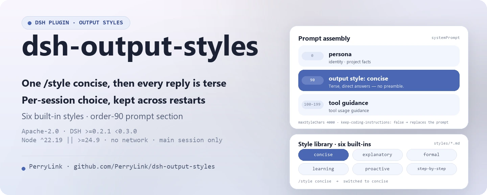

<div align="center">

<picture>
  <source media="(prefers-color-scheme: dark)" srcset="docs/assets/dsh-output-styles-hero-en-dark.webp">
  
</picture>

# dsh-output-styles

**Troque o estilo de saída do modelo em tempo de execução: um `/style concise` e todas as respostas passam a ser concisas.**

O equivalente de `outputStyles` do Claude Code para o DeepSeek Harness: os estilos são arquivos Markdown, a escolha é persistida por sessão e o corpo é injetado em cada montagem do prompt.

[Instalar](#instalação-em-três-passos) · [Configuração](#configuração) · [FAQ](#faq) · [简体中文](README.md) · [English](README.en.md) · [Español](README.es.md) · [Português](README.pt.md) · [हिन्दी](README.hi.md)

[](LICENSE)
[](#compatibilidade)
[](https://www.npmjs.com/package/dsh-output-styles)
[](https://github.com/PerryLink/dsh-output-styles/actions/workflows/ci.yml)
[](#compatibilidade)

[](https://github.com/PerryLink/dsh-output-styles/stargazers)
[](https://www.npmjs.com/package/dsh-output-styles)
[](https://dshfind.com/plugins/PerryLink/dsh-output-styles?ref=badge)
[](https://securityscorecards.dev/viewer/?uri=github.com/PerryLink/dsh-output-styles)
[](https://dsh.market/)
[](https://gitee.com/perrylink/dsh-output-styles)

```sh
dsh plugin --profile <name> add dsh-output-styles
```

</div>

<sub>Plugin da comunidade, sem afiliação com a DeepSeek. Repositório canônico: <https://github.com/PerryLink/dsh-output-styles> (o Gitee é um espelho).</sub>

## O que é

`/style concise` — e a partir de agora toda resposta é concisa; `/style off` — de volta ao padrão do projeto. O `dsh-output-styles` traz o `outputStyles` do Claude Code para o DeepSeek Harness: um estilo é um arquivo Markdown (frontmatter para metadados, corpo como diretiva do modelo), seis vêm embutidos, a escolha vive no domínio de armazenamento `output_style` indexada por sessionId e sobrevive a reinícios, e o corpo atual é injetado no prompt do sistema em cada montagem, truncado em um orçamento configurável. Os estilos se aplicam apenas à conversa principal; sessões de subagente mantêm os próprios prompts (igual ao Claude Code).

<p align="center">
  <picture>
    <source media="(prefers-color-scheme: dark)" srcset="docs/assets/dsh-output-styles-flow-v5-dark.svg">
    
  </picture>
</p>

### Como funciona

```mermaid
flowchart LR
    U[You type /style concise] --> C[command registry]
    C -->|command/run logged| L[(session log)]
    C -->|put {style, source}| D[(output_style domain)]
    D --> R[OutputStyleRuntime]
    R -->|body at every assembly| S[systemPrompt section order 90]
    S --> M[Model request]
    M -->|full system prompt| H[system/message logged]
```

Tudo o que o modelo vê é reconstruível a partir do registro de sessão: sem novo tipo de evento de sessão, sem mudanças no agent-loop. O nome do estilo vem de `command/run`, o texto exato injetado de `system/message`, e o marcador de procedência `{ kind: 'dsh-output-styles' }` viaja no registro do domínio.

### Demonstração

```text
You > /style
      output style off
      concise — Terse, direct answers — minimal prose, no preamble. (Daily coding work, tool-heavy sessions, or when prompt length matters.)
      explanatory — Educational answers with short "Insights" that teach as you work. (Learning a codebase, onboarding, …)
      formal — Formal, precise prose with complete sentences and defined terms. (Reports, documentation, release notes, …)
      learning — Collaborative learn-by-doing mode with short "Insights" and small hands-on steps for the user. (Pairing, onboarding, …)
      proactive — Execute immediately, assume reasonable defaults, and prefer action over planning. (Routine multi-step work, …)
      step-by-step — Numbered reasoning steps with explicit intermediate results. (Debugging, design decisions, …)

You > /style concise
      switched to concise

You > 请只用一句话介绍你自己。
AI  > 我是运行在 DeepSeek Harness 插件化平台上、基于 deepseek-v4-pro 模型的 AI 编码代理。
```

## Instalação em três passos

1. **Instalar** (escolha um canal):

   ```sh
   # canal git (main mais recente; o script prepare compila só com dependências de produção)
   dsh plugin --profile web add github:PerryLink/dsh-output-styles
   # canal npm (versões publicadas)
   dsh plugin --profile web add dsh-output-styles
   # canal tarball: pnpm pack neste repositório e depois
   dsh plugin --profile web add ./dsh-output-styles-<version>.tgz
   ```

2. **Configuração mínima** (os padrões já funcionam; defina o estilo do projeto para sessões novas se precisar):

   ```yaml
   - insert:
       - id: output-styles
         name: dsh-output-styles
         config:
           defaultStyle: concise
   ```

3. **Verificar que funciona**:

   ```sh
   dsh --profile web --dump-config | grep -A3 'id: output-styles'
   ```

   ```text
   > /style
         output style off
         concise — Terse, direct answers — minimal prose, no preamble. (…)
   > /style concise
         switched to concise
   ```

**Desinstalar**: `dsh plugin --profile web remove dsh-output-styles` (ou remova a linha do patch do perfil).

<details>
<summary>Instalar a partir do mercado do DSH Desktop</summary>

Todos os plugins da PerryLink aparecem no mercado embutido do DSH Desktop: **Mercado → Fontes → Adicionar fonte → cole** `https://perrylink-dsh-catalog.perrylink.workers.dev/catalog-source.json` **→ selecione**. A instalação continua exigindo a verificação de identidade npm do mercado e a sua confirmação.

</details>

## Capacidades principais

O `dsh-output-styles` é o equivalente de `outputStyles` do Claude Code para o DeepSeek Harness: um comando `/style` que troca o estilo de saída do modelo em tempo de execução, persiste por sessão e injeta em cada montagem do prompt.

- **Biblioteca de estilos** — um arquivo Markdown por estilo (`styles/*.md`); frontmatter para metadados, corpo = a diretiva do modelo. Seis estilos embutidos (`concise`, `explanatory`, `formal`, `learning`, `proactive`, `step-by-step`), incluindo `proactive` e `learning` com paridade Claude Code.
- **Comando `/style`** — sem argumento lista os estilos (com descrições) e a seleção atual; `/style <name>` troca; `/style off` restaura o padrão do projeto.
- **Persistência por sessão** — a escolha vive no domínio de armazenamento `output_style`, indexada por sessionId, e sobrevive a reinícios.
- **Injeção no prompt do sistema** — uma contribuição `systemPrompt.section()` (ordem `sectionOrder`) injeta o corpo do estilo atual em cada montagem, truncado em um orçamento configurável.
- **Paridade Claude Code** — `keep-coding-instructions`, `force-for-plugin` (alias `force`), compatibilidade JSON `outputStyles`, diretórios `stylesDir` em camadas, recarga a quente e um fallback do projeto editável ao vivo na página **Plugins** da Web.
- **Registro de renderers (`output.render.*`)** — `ctx.outputRenderers` permite que qualquer plugin registre um presenter puro, aplicado pela cascata `output.render/before`; renderers embutidos `concise` e `step-by-step`.
- **Regras por sessão/por ferramenta** — `rules: [{ match: { tool: 'bash' }, style: 'concise' }]` nomeiam o renderer para requisições correspondentes; editáveis ao vivo na página **Plugins** da Web.
- **`/transcript`** — renderiza a sessão atual em Markdown ou HTML sanitizado pela pipeline de render; `--save <path>` grava o documento sanitizado nesse caminho do workspace após a aprovação do usuário. Cada render mantém o texto original ao lado do renderizado.

### Superfície de comandos e ferramentas

| Superfície | Tipo | Notas |
|---|---|---|
| `/style` | command | Lista estilos, troca ou restaura o padrão do projeto |
| `/transcript` | command | Renderiza a sessão atual em Markdown ou HTML sanitizado; `--save` grava com aprovação |
| `output_style` | storage domain | Escolha de estilo por sessão, indexada por sessionId |
| `systemPrompt.section()` | contribution | Injeta o corpo do estilo atual em cada montagem |
| `output.render.*` | renderer registry | `ctx.outputRenderers` + a cascata `output.render/before` |
| `style` | projection | `{ options, currentValue }` dobrado a partir de comandos assentados |
| Web picker | client entry | `dsh-output-styles/client` decora `/style` com um seletor pop-up |

### Referência de comandos

| Entrada | Resultado |
|---|---|
| `/style` | Lista a seleção atual + uma linha por estilo (nome — descrição) |
| `/style concise` | Troca (gravação durável), `switched to concise` |
| `/style Diagrams first` | Nomes com várias palavras são o restante inteiro |
| `/style off` | Restaura o padrão do projeto (padrão de settings, depois `defaultStyle`) |
| `/style nope` | `error: unknown output style "nope" (available: …)` |
| `/transcript` | Renderiza a sessão atual em Markdown pela pipeline de render |
| `/transcript md` | Renderiza em Markdown (`md` é a forma abreviada de `markdown`) |
| `/transcript html` | Renderiza em HTML sanitizado |
| `/transcript --renderer=concise` | Renderiza forçando um renderer (regras ignoradas) |
| `/transcript md --save report.md` | Renderiza e depois grava o documento sanitizado em `report.md` após aprovação |

### Exemplos

Estes são os pontos de entrada reais do plugin; instale uma vez e chame um.

**Exemplo detalhado** — comando `/style concise`, saída:

```text
switched to concise
```

*Observed from `plugins/dsh-output-styles/src/runtime.ts:474-478; asserted in tests/runtime.spec.ts:91; README §Command reference line 194`*

**Ramo de falha** — entrada `/style nope`, saída:

```text
unknown output style "nope" (available: concise, explanatory, formal, learning, proactive, step-by-step)
```

*Observed from `plugins/dsh-output-styles/src/runtime.ts:213-214,474-475; plugins/dsh-output-styles/tests/runtime.spec.ts:118-125`*

**Exemplos curtos**: `/transcript` · `output_style`

### Biblioteca de estilos

Um arquivo Markdown por estilo; frontmatter para metadados, corpo = a diretiva do modelo. `name` usa por padrão o nome do arquivo e pode conter espaços (`Diagrams first`).

| Campo | Padrão | Significado |
|---|---|---|
| `name` | nome do arquivo | Destino da troca; letras, dígitos, espaços e hífens (`off` é reservado) |
| `description` | — (obrigatório) | Uma frase mostrada nas listagens e no seletor |
| `whenToUse` | — | Orientação opcional anexada às listagens |
| `keep-coding-instructions` | `false` | Manter o prompt do harness quando `true`; substituí-lo quando `false` (semântica Claude Code) |
| `force-for-plugin` | `false` | Aplicar incondicionalmente, sobrepondo qualquer seleção de sessão; `force` é um alias, no máximo um estilo pode defini-lo |

Com `compatJson: true`, entradas JSON `outputStyles` do Claude Code (`{ name, description, prompt }`) carregam ao lado dos estilos Markdown; entradas não analisáveis são ignoradas com um aviso.

### Protocolo de renderers

O protocolo `output.render.*` transforma a apresentação em um ponto de extensão. Um renderer é um **presenter puro** — `presenter(text, context)` mapeia argumentos para dados de exibição, nunca toca no DOM — combinado por nome de ferramenta e tipo de conteúdo, ordenado por prioridade.

- **Waterfall primeiro**: toda requisição de render passa por `output.render/before` (`{ text, context }`); os listeners devem chamar `next()`.
- **Rules**: `rules: [{ match: { tool: 'bash' }, style: 'concise' }]` nomeia o renderer para requisições correspondentes; empates são decididos por `priority` e depois pela ordem da regra.
- **Built-ins**: `concise` (compactação de espaços + truncamento por orçamento) e `step-by-step` (numeração de passos consistente).
- **Auditabilidade**: cada resultado de render carrega `{ original, rendered, rendererId, changed }`; o texto renderizado é o que aparece, o original continua reconstruível a partir do registro de sessão.

### Seletor Web

A entrada `dsh.client` decora a invocação nua do comando `/style` com um seletor pop-up: uma linha "off" mais uma linha por estilo da biblioteca (`description · whenToUse`), com a linha ativa marcada. A escolha envia `/style <name>` pelo Remote de comandos, então cada troca mantém o ciclo de vida durável do comando host. O seletor segue o par de idiomas `zh`/`en` da Web UI.

## Configuração

Todos os ajustes são campos Schemastery `Config` (alteráveis no cordis.yml). Valores inválidos falham no carregamento.

`defaultStyle` e `rules` são declarados `volatile()`, então em um host que compõe a costura de formulários de settings eles são **campos vivos, editáveis na Web**: edite-os em **Plugins → dsh-output-styles** na interface Web e o plugin em execução adota o novo valor sem remontar. Todos os outros campos continuam apenas de composição e precisam de recarga. Um valor confirmado é validado antes de ser aplicado — se for inválido é rejeitado e os valores em execução não mudam.

Chaves mais usadas:

| Chave | Padrão | Editável na Web | Significado |
|---|---|---|---|
| `stylesDir` | `[]` | Não | Diretórios da biblioteca, resolvidos contra o cwd; entradas posteriores sobrepõem as anteriores. `[]` = apenas os `styles/` embutidos |
| `maxStyleChars` | `4000` | Não | Orçamento do corpo do estilo (≥ 1); corpos maiores são truncados com um marcador |
| `defaultStyle` | `''` | **Sim** | Estilo para sessões que nunca escolheram um; `''` = sem estilo. Um nome que não está na biblioteca viva é recusado em vez de injetado |
| `compatJson` | `true` | Não | Carregar entradas JSON `outputStyles` do Claude Code (objetos únicos ou arrays) |
| `sectionOrder` | `90` | Não | Ordem da seção injetada (0 = persona, 100–199 = orientação de ferramentas) |
| `includeBuiltins` | `true` | Não | Incluir os `styles/` do pacote como camada de menor prioridade |
| `watchStyles` | `true` | Não | Recarregar a biblioteca quando um arquivo de estilo muda no disco |
| `rules` | `[]` | **Sim** | Regras de render por sessão/por ferramenta: `[{ match: { tool?, contentType?, session? }, style, priority? }]` |

<details>
<summary>Tabela de configuração completa (11 chaves)</summary>

| Chave | Padrão | Editável na Web | Significado |
|---|---|---|---|
| `stylesDir` | `[]` | Não | Diretórios da biblioteca, resolvidos contra o cwd; entradas posteriores sobrepõem as anteriores. `[]` = apenas os `styles/` embutidos |
| `maxStyleChars` | `4000` | Não | Orçamento do corpo do estilo (≥ 1); corpos maiores são truncados com um marcador |
| `defaultStyle` | `''` | **Sim** | Estilo para sessões que nunca escolheram um; `''` = sem estilo. Um nome que não está na biblioteca viva é recusado em vez de injetado |
| `compatJson` | `true` | Não | Carregar entradas JSON `outputStyles` do Claude Code (objetos únicos ou arrays) |
| `sectionOrder` | `90` | Não | Ordem da seção injetada (0 = persona, 100–199 = orientação de ferramentas) |
| `truncationMarker` | `"\n\n[style truncated]"` | Não | Marcador anexado no ponto de truncamento |
| `includeBuiltins` | `true` | Não | Incluir os `styles/` do pacote como camada de menor prioridade |
| `watchStyles` | `true` | Não | Recarregar a biblioteca quando um arquivo de estilo muda no disco |
| `rules` | `[]` | **Sim** | Regras de render por sessão/por ferramenta: `[{ match: { tool?, contentType?, session? }, style, priority? }]` |
| `enableExport` | `true` | Não | Registrar o comando `/transcript` (exportação de sessão Markdown/HTML, ciente do renderer; `--save` grava com aprovação) |
| `respectCoreOutputStyles` | `true` | Não | Ao detectar um serviço core `outputStyles`, pular a injeção de prompt deste plugin (manter hot-switch / rules / export) |

</details>

Exemplo de override no patch do perfil:

```yaml
- insert:
    - id: output-styles
      name: dsh-output-styles
      config:
        defaultStyle: concise
        rules:
          - match: { tool: bash }
            style: concise
```

**Migração de 0.1.6 ou anterior.** Essas versões mantinham duas seções de settings próprias do plugin, `output-style` (`style`) e `output-style-rules` (`rules`). O host 0.1.7 removeu a API sobre a qual foram construídas, então as duas seções deixaram de existir. Mova qualquer valor que estivesse ali para o campo `Config` correspondente — `output-style.style` → `defaultStyle`, `output-style-rules.rules` → `rules` — no patch do seu perfil (`cordis.yml`), ou defina na página Plugins. As escolhas por sessão feitas com `/style` não são afetadas: elas vivem no domínio de armazenamento `output_style`.

## FAQ

<details>
<summary>Onde a escolha de estilo é guardada? Sobrevive a um reinício?</summary>

A escolha vive no domínio de armazenamento `output_style`, indexada por sessionId, e sobrevive a reinícios. Nenhum outro estado é persistido e não há requisições de rede. Os corpos de estilo vêm dos diretórios `styles/` e de `stylesDir`; são relidos em cada montagem (com `watchStyles` ativo, também recarregam a quente).

</details>

<details>
<summary>Mudei o `defaultStyle` na Web e nada aconteceu — por quê?</summary>

`defaultStyle` e `rules` são campos `volatile()`: só são campos vivos editáveis na Web quando o host compõe a costura de formulários de settings. Caso contrário, continuam apenas de composição e exigem recarregar o perfil. Um valor confirmado é validado — um nome inválido é rejeitado e os valores em execução não mudam.

</details>

<details>
<summary>E se o core lançar um `outputStyles` de primeira parte?</summary>

Não há conflito silencioso. Quando o plugin detecta um serviço core `outputStyles`, degrada para a superfície incremental (hot-switch / rules / `/transcript`) e deixa a injeção do prompt para o core; cada resposta de `/style` e `/style off` carrega uma nota `degraded coexistence mode`, e a projeção de sessão `style` expõe `promptInjection: 'enabled' | 'disabled'`, então nenhuma superfície insinua que o estilo está em vigor quando não está. O argumento completo está em [`docs/COEXISTENCE.md`](docs/COEXISTENCE.md).

</details>

<details>
<summary>Qual é o custo de desempenho?</summary>

Sem requisições de rede e sem chamadas ao modelo. O plugin observa `system-prompt/assemble` e incorpora o corpo do estilo atual (truncado em `maxStyleChars`, 4000 caracteres por padrão) ao prompt do sistema; todos os listeners delegam por `next()`, então a cadeia nunca é curto-circuitada.

</details>

<details>
<summary>Sessões de subagente herdam o estilo?</summary>

Não. Os estilos se aplicam apenas à conversa principal; sessões de subagente mantêm os próprios prompts, igual ao Claude Code.

</details>

## Limites de segurança

- **Apenas serviços públicos.** Contribui com `systemPrompt`, comandos, armazenamento e settings; sem mudanças em engine / agent-loop / apiproxy / UI oficial.
- **Visível ao modelo ⟺ registrado.** Tudo o que o modelo vê é reconstruível a partir do registro de sessão — sem novo tipo de evento de sessão, sem mudanças no agent-loop.
- **Original sempre preservado.** Cada render (e `/transcript`) mantém o texto original ao lado do renderizado; para exportação HTML usa-se HTML sanitizado.
- **Gravações em disco com portão.** `/transcript --save` só grava depois que o serviço de aprovação concede, e o conteúdo gravado passa antes pela função pura `sanitizeText`; sem um serviço de aprovação ou fs não grava nada (fail-closed).

## Permissões e dados

- **Permissões**: o manifesto de workshop declara `fs:read`, `fs:write`, `fs:watch`, `storage:read`, `storage:write` e `settings:read`.
- **Dados**: a escolha de estilo vive no domínio de armazenamento `output_style` (indexada por sessionId); nenhum outro estado é persistido, sem requisições de rede.
- **Registro de sessão**: o nome do estilo vem de `command/run`, o texto exato injetado de `system/message`; o marcador de procedência `{ kind: 'dsh-output-styles' }` viaja no registro do domínio.

## Limitações conhecidas

- **Coexistência com o core.** Se surgir uma capacidade `outputStyles` de primeira parte, este plugin detecta o serviço `outputStyles` e degrada para a superfície incremental (hot-switch, rules, `/transcript`), deixando a injeção do prompt para o core — veja [`docs/COEXISTENCE.md`](docs/COEXISTENCE.md) e as funções exportadas `detectCoreOutputStyles` / `coexistenceReport`. **O modo degradado é declarado onde você vê**: cada resposta de `/style <estilo>` e `/style off` carrega uma nota `degraded coexistence mode`, e a projeção de sessão `style` expõe `promptInjection: 'enabled' | 'disabled'`, então nenhuma superfície insinua que o estilo está em vigor quando não está. (Antes de 0.7.0 o único rastro era uma linha `ctx.logger.info`, que nunca chega à transcrição.)
- **Apenas conversa principal.** Os estilos se aplicam à conversa principal; sessões de subagente mantêm os próprios prompts (igual ao Claude Code).
- **Truncamento.** Corpos de estilo maiores que `maxStyleChars` são truncados com um marcador.
- **Arquivos ignorados.** Um arquivo de estilo defeituoso é ignorado com um aviso e nunca quebra o profile.

## Interoperabilidade com outros plugins DSH

Verificado contra **DSH `0.2.0-rc.2`** (o runtime para o qual este README é publicado) e o conjunto de plugins com mais estrelas sondado em 2026-10-05.

Este plugin **não interfere** em outros plugins, incluindo os de mais estrelas:

- **Sem colisão de nomes de ferramenta.** Todas as ferramentas têm namespace; nenhum nome nu pertencente a uma ferramenta embutida ou a outro plugin é registrado.
- **Sem colisão de chave de serviço.** Só fornece `outputRenderers`; essa chave não é uma costura embutida nem é fornecida por nenhum plugin de mais estrelas.
- **Sem colisão de slot.** Não registra nenhuma chave de slot de cliente, então não disputa um assento `shadows-shipped-ui`.
- **Sem colisão de rota HTTP.** Não registra nenhum prefixo `webServer`.
- **Sem colisão na camada de patch.** O patch do bundle apenas faz `insert` da própria linha; nunca sobrescreve o `config` de uma linha embutida.
- **Sem mutação global.** Não altera protótipos, não reescreve `process.env`, nem substitui o dispatcher global de fetch.

**Listeners de eventos compartilhados não interferem por construção.** Observa o evento sensível à ordem `system-prompt/assemble` com `ctx.on()` — o registro de broadcast do Cordis, onde cada listener executa e nenhum pode deixar outro sem vez. **Todos os listeners aqui delegam por `next()`**, então a cadeia nunca é curto-circuitada:

- `system-prompt/assemble` — also used by `dsh-routing-suite` (7000★, 13 listeners).

Evidência estática: `dsh-plugin-doctor` K10–K13 dão `pass` em todas as verificações deste repositório.

### Verificação de conflitos

Filtrado contra o ecossistema DSH antes do desenvolvimento (instantâneo de 2026-08): nenhum repositório `style`/`output-style` sob [topic:dsh-plugin](https://github.com/topics/dsh-plugin), nenhuma categoria de output-style nas quatro principais [awesome lists](https://github.com/awesome-dsh-plugin/awesome-dsh-plugin), e nenhuma entrada no [catálogo dsh-hub](https://github.com/omdsh-dev/dsh-hub-workshop). Os vizinhos mais próximos — [dsh-soul-md](https://github.com/Scorp1o117/dsh-soul-md) (persona) e [dsh-claude-marketplace](https://github.com/ben7am1n/dsh-claude-marketplace) (estilos de saída explicitamente adiados para v0.2+) — são adjacentes, não conflitantes.

## Compatibilidade

| Superfície | Estado |
|---|---|
| Harness | DeepSeek Harness `dsh-v0.2.1-rc.2` (adaptado em 2026-09-09): o envelope de sessão mantém seu campo ignorable apenas para compatibilidade de leitura de logs armazenados — Session.append ainda não consegue estampá-lo, então o comportamento do portão não muda. Verificado em 2026-09-11 contra o checkout dsh-v0.2.1-rc.2 (cadeia completa de portões + smoke de instalação do perfil). |
| Node | `^22.19.0 \|\| >=24.9.0` |
| Plataformas | Todas (host + cliente web) |
| Modelo | Qualquer (injeção no prompt do sistema) |

### Diferenças em relação ao Claude Code

| | Claude Code | dsh-output-styles |
|---|---|---|
| Arquivos de estilo | `.claude/output-styles` nos níveis usuário/projeto/gerenciado | diretórios `stylesDir` + `styles/` embutidos, o diretório posterior vence |
| Estilos personalizados | Markdown, frontmatter `name`/`description`/`keep-coding-instructions`/`force-for-plugin` | Mesmos campos (`force-for-plugin` aceito literalmente, `force` como alias) + `whenToUse` |
| JSON legado | array `outputStyles` em `settings.json` | Carregado literalmente (`compatJson: true`) |
| Quando entra em vigor | Depois de `/clear` ou uma nova sessão | Imediatamente — o prompt do sistema é remontado por requisição |
| Subagentes | Os estilos não se aplicam | Igual — sessões de subagente mantêm os próprios prompts |
| Troca | menu `/config` ou ajuste `outputStyle` (o comando `/output-style` foi removido na v2.1.91) | comando `/style` + Web picker + campo `defaultStyle` na página Plugins da Web |

## Ecossistema e qualidade

- [Espelho no Gitee](https://gitee.com/perrylink/dsh-output-styles) (espelho de sincronização; o GitHub é canônico)
- [Página do plugin no dshfind](https://dshfind.com/plugins/PerryLink/dsh-output-styles) (instalações e ranking)
- [Relatório do OpenSSF Scorecard](https://securityscorecards.dev/viewer/?uri=github.com/PerryLink/dsh-output-styles) (movido por [.github/workflows/scorecard.yml](.github/workflows/scorecard.yml))
- [Relatório de verificação do dsh-plugin-doctor](https://github.com/PerryLink/dsh-plugin-doctor#verified-徽章) (K10–K13 todos `pass`)
- [DSH Market](https://dsh.market/) (listado)
- **Canal da loja 1024**: rode `npm i -g dsh1024` uma vez e depois `dsh1024 plugin --profile web add dsh-output-styles` (conta para o ranking de instalações do [deepseek1024.com](https://deepseek1024.com))
- [Base de conhecimento do ecossistema](https://perrylink.github.io/dsh-plugin-guide/) — dados medidos, não marketing: guia de desenvolvimento de plugins · dados de seleção · critérios de manutenção

## Desenvolvimento

```sh
pnpm install
pnpm run typecheck     # ambos os projetos tsc
pnpm test              # vitest — 156 testes
pnpm run verify        # typecheck + testes + self-contained (o portão do prepublishOnly)
pnpm run check:readmes # portão de consistência dos README em cinco idiomas
pnpm run build         # artefatos lib/ (bundles host + client)
pnpm pack              # tarball para dsh plugin add
```

Lançamentos: empurrar uma tag `v*` cujo sufixo corresponde à versão do `package.json` dispara o workflow Publish — verificação completa e depois publicação no npm com procedência.

As imagens do README são geradas programaticamente por [`scripts/gen-readme-assets.py`](scripts/gen-readme-assets.py): o banner é um WebP de 1440×576 desenhado com Pillow (zh/en × claro/escuro) e o diagrama de estrutura é um SVG escrito à mão de 1100×660 (claro/escuro). Reexecutá-lo sobrescreve `docs/assets/dsh-output-styles-hero-*` e `docs/assets/dsh-output-styles-flow-v5-{light,dark}.svg`. Este repositório não tem dados de benchmark, então não há gráfico de evidência.

Topics: `deepseek-harness`, `dsh`, `dsh-plugin`, `output-style`, `output-styles`, `claude-code`

## Família e agradecimentos

Este projeto faz parte da família de plugins de DeepSeek Harness da [PerryLink](https://github.com/PerryLink) (todos Apache-2.0). Se for útil, **uma estrela ajuda a próxima pessoa a encontrá-lo** — nada fica bloqueado por trás dela.

- [@kskazuha](https://github.com/kskazuha) — o renascimento do seletor de estilos Web na 0.1.7 (#8).
- [@Bingtang1019](https://github.com/Bingtang1019) — o relatório de passagem da tabela de módulos de `lib/client.js` (#10).
- [@PerryLink](https://github.com/PerryLink) — autor e mantenedor: arquitetura do plugin, biblioteca de estilos, instalação de bundle, Web picker, documentação em cinco idiomas e ferramentas de CI/lançamento.

<details>
<summary>Expandir todos os plugins</summary>

| Plugin | Estado |
|---|---|
| **[dsh-aqua-input-check](https://github.com/PerryLink/dsh-aqua-input-check)** |  |
| **[dsh-archive-check](https://github.com/PerryLink/dsh-archive-check)** |  |
| **[dsh-auto-review](https://github.com/PerryLink/dsh-auto-review)** |  |
| **[dsh-autotier](https://github.com/PerryLink/dsh-autotier)** | 🧊 CONGELADO — ver o README do repo |
| **[dsh-bid-ca-precheck](https://github.com/PerryLink/dsh-bid-ca-precheck)** |  |
| **[dsh-bid-qual-check](https://github.com/PerryLink/dsh-bid-qual-check)** |  |
| **[dsh-cert-mcp](https://github.com/PerryLink/dsh-cert-mcp)** | 🧊 CONGELADO — ver o README do repo |
| **[dsh-checkpoint-rewind](https://github.com/PerryLink/dsh-checkpoint-rewind)** |  |
| **[dsh-click](https://github.com/PerryLink/dsh-click)** |  |
| **[dsh-composer-history](https://github.com/PerryLink/dsh-composer-history)** |  |
| **[dsh-contract-stance](https://github.com/PerryLink/dsh-contract-stance)** |  |
| **[dsh-customs-doc-check](https://github.com/PerryLink/dsh-customs-doc-check)** |  |
| **[dsh-data-quality](https://github.com/PerryLink/dsh-data-quality)** | 🧊 CONGELADO — ver o README do repo |
| **[dsh-demurrage-ledger](https://github.com/PerryLink/dsh-demurrage-ledger)** |  |
| **[dsh-doublecheck](https://github.com/PerryLink/dsh-doublecheck)** |  |
| **[dsh-drill-script-check](https://github.com/PerryLink/dsh-drill-script-check)** |  |
| **[dsh-eia-guide-check](https://github.com/PerryLink/dsh-eia-guide-check)** |  |
| **[dsh-emergency-plan](https://github.com/PerryLink/dsh-emergency-plan)** |  |
| **[dsh-essay-rubric-check](https://github.com/PerryLink/dsh-essay-rubric-check)** |  |
| **[dsh-evidence-check](https://github.com/PerryLink/dsh-evidence-check)** |  |
| **[dsh-export-ctl-check](https://github.com/PerryLink/dsh-export-ctl-check)** |  |
| **[dsh-fast](https://github.com/PerryLink/dsh-fast)** |  |
| **[dsh-fmea-table-check](https://github.com/PerryLink/dsh-fmea-table-check)** |  |
| **[dsh-forecast-penalty](https://github.com/PerryLink/dsh-forecast-penalty)** |  |
| **[dsh-fund-research](https://github.com/PerryLink/dsh-fund-research)** |  |
| **[dsh-github](https://github.com/PerryLink/dsh-github)** |  |
| **[dsh-gongwen-flow-check](https://github.com/PerryLink/dsh-gongwen-flow-check)** |  |
| **[dsh-gongwen-word-check](https://github.com/PerryLink/dsh-gongwen-word-check)** |  |
| **[dsh-guard-plan-qc](https://github.com/PerryLink/dsh-guard-plan-qc)** |  |
| **[dsh-hazchem-check](https://github.com/PerryLink/dsh-hazchem-check)** |  |
| **[dsh-hazplan-check](https://github.com/PerryLink/dsh-hazplan-check)** |  |
| **[dsh-hidden-risk-map](https://github.com/PerryLink/dsh-hidden-risk-map)** |  |
| **[dsh-hs-classify](https://github.com/PerryLink/dsh-hs-classify)** |  |
| **[dsh-icd-rule-check](https://github.com/PerryLink/dsh-icd-rule-check)** |  |
| **[dsh-industry-research](https://github.com/PerryLink/dsh-industry-research)** |  |
| **[dsh-lawcite-adapter](https://github.com/PerryLink/dsh-lawcite-adapter)** |  |
| **[dsh-laya](https://github.com/PerryLink/dsh-laya)** |  |
| **[dsh-lc-doc-check](https://github.com/PerryLink/dsh-lc-doc-check)** |  |
| **[dsh-learning-gap-check](https://github.com/PerryLink/dsh-learning-gap-check)** |  |
| **[dsh-library](https://github.com/PerryLink/dsh-library)** |  |
| **[dsh-local-ai](https://github.com/PerryLink/dsh-local-ai)** |  |
| **[dsh-lsp-actions](https://github.com/PerryLink/dsh-lsp-actions)** |  |
| **[dsh-mask](https://github.com/PerryLink/dsh-mask)** |  |
| **[dsh-mcp-panel](https://github.com/PerryLink/dsh-mcp-panel)** |  |
| **[dsh-medrec-qc](https://github.com/PerryLink/dsh-medrec-qc)** |  |
| **[dsh-memento](https://github.com/PerryLink/dsh-memento)** | 🧊 CONGELADO — ver o README do repo |
| **[dsh-nsfc-form-check](https://github.com/PerryLink/dsh-nsfc-form-check)** |  |
| **[dsh-nurse-record-check](https://github.com/PerryLink/dsh-nurse-record-check)** |  |
| **[dsh-observe](https://github.com/PerryLink/dsh-observe)** |  |
| **[dsh-origin-rvc-check](https://github.com/PerryLink/dsh-origin-rvc-check)** |  |
| **[dsh-ota-review-check](https://github.com/PerryLink/dsh-ota-review-check)** |  |
| **[dsh-output-styles](https://github.com/PerryLink/dsh-output-styles)** |  |
| **[dsh-paper-doc-adapter](https://github.com/PerryLink/dsh-paper-doc-adapter)** |  |
| **[dsh-permission-rules](https://github.com/PerryLink/dsh-permission-rules)** |  |
| **[dsh-permit-report-check](https://github.com/PerryLink/dsh-permit-report-check)** |  |
| **[dsh-pipeline-check](https://github.com/PerryLink/dsh-pipeline-check)** |  |
| **[dsh-pleading-draft](https://github.com/PerryLink/dsh-pleading-draft)** |  |
| **[dsh-plugin-doctor](https://github.com/PerryLink/dsh-plugin-doctor)** | 🚫 APOSENTADO (repo arquivado) |
| **[dsh-plugin-guide](https://github.com/PerryLink/dsh-plugin-guide)** |  |
| **[dsh-plugin-kit](https://github.com/PerryLink/dsh-plugin-kit)** | 🚫 APOSENTADO (repo arquivado) |
| **[dsh-plugin-upgrade](https://github.com/PerryLink/dsh-plugin-upgrade)** | 🚫 APOSENTADO (repo arquivado) |
| **[dsh-policy-brief-draft](https://github.com/PerryLink/dsh-policy-brief-draft)** |  |
| **[dsh-power-loss-split](https://github.com/PerryLink/dsh-power-loss-split)** |  |
| **[dsh-power-ticket-check](https://github.com/PerryLink/dsh-power-ticket-check)** |  |
| **[dsh-ppap-check](https://github.com/PerryLink/dsh-ppap-check)** |  |
| **[dsh-protest-deadline](https://github.com/PerryLink/dsh-protest-deadline)** |  |
| **[dsh-railway-window](https://github.com/PerryLink/dsh-railway-window)** |  |
| **[dsh-repair-order-qc](https://github.com/PerryLink/dsh-repair-order-qc)** |  |
| **[dsh-research-report](https://github.com/PerryLink/dsh-research-report)** |  |
| **[dsh-review-reply-check](https://github.com/PerryLink/dsh-review-reply-check)** |  |
| **[dsh-rulefile-check](https://github.com/PerryLink/dsh-rulefile-check)** |  |
| **[dsh-safety-brief-check](https://github.com/PerryLink/dsh-safety-brief-check)** |  |
| **[dsh-score](https://github.com/PerryLink/dsh-score)** | 🧊 CONGELADO — ver o README do repo |
| **[dsh-session-sync](https://github.com/PerryLink/dsh-session-sync)** |  |
| **[dsh-site-log-check](https://github.com/PerryLink/dsh-site-log-check)** |  |
| **[dsh-skill-pack-security](https://github.com/PerryLink/dsh-skill-pack-security)** |  |
| **[dsh-soe-decision-check](https://github.com/PerryLink/dsh-soe-decision-check)** |  |
| **[dsh-soilwater-check](https://github.com/PerryLink/dsh-soilwater-check)** |  |
| **[dsh-sop-sync-check](https://github.com/PerryLink/dsh-sop-sync-check)** |  |
| **[dsh-spc-gbt-adapter](https://github.com/PerryLink/dsh-spc-gbt-adapter)** |  |
| **[dsh-talk](https://github.com/PerryLink/dsh-talk)** |  |
| **[dsh-tender-extract](https://github.com/PerryLink/dsh-tender-extract)** |  |
| **[dsh-tender-matrix](https://github.com/PerryLink/dsh-tender-matrix)** |  |
| **[dsh-test-drive](https://github.com/PerryLink/dsh-test-drive)** |  |
| **[dsh-ticktick](https://github.com/PerryLink/dsh-ticktick)** | 🚫 APOSENTADO (repo arquivado) |
| **[dsh-translate](https://github.com/PerryLink/dsh-translate)** |  |
| **[dsh-warranty-calc](https://github.com/PerryLink/dsh-warranty-calc)** |  |
| **[dsh-budget](https://github.com/PerryLink/dsh-budget)** | 🧊 CONGELADO — ver o README do repo |
| **[dsh-claude-move](https://github.com/PerryLink/dsh-claude-move)** | 🧊 CONGELADO — ver o README do repo |
| **[dsh-defend](https://github.com/PerryLink/dsh-defend)** | 🧊 CONGELADO — ver o README do repo |
| **[dsh-draw](https://github.com/PerryLink/dsh-draw)** | 🧊 CONGELADO — ver o README do repo |
| **[dsh-reach](https://github.com/PerryLink/dsh-reach)** | 🧊 CONGELADO — ver o README do repo |
| **[dsh-background-agents](https://github.com/PerryLink/dsh-background-agents)** | 🚫 APOSENTADO (repo arquivado) |
| **[dsh-session-pin](https://github.com/PerryLink/dsh-session-pin)** | 🚫 APOSENTADO (repo arquivado) |
| **[dsh-team-rooms](https://github.com/PerryLink/dsh-team-rooms)** | 🚫 APOSENTADO (repo arquivado) |

</details>

## Licença

[LICENSE](LICENSE) (Apache License 2.0) © 2026 dsh-output-styles contributors

<p align="center"><sub>Apache-2.0 · Plugin da comunidade, sem afiliação com a DeepSeek.</sub></p>
